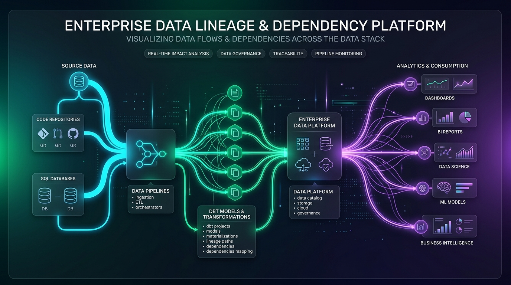
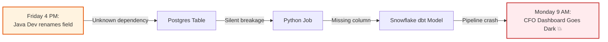
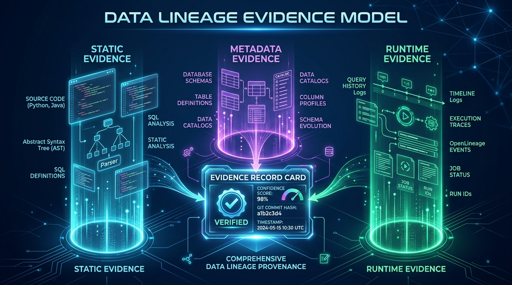
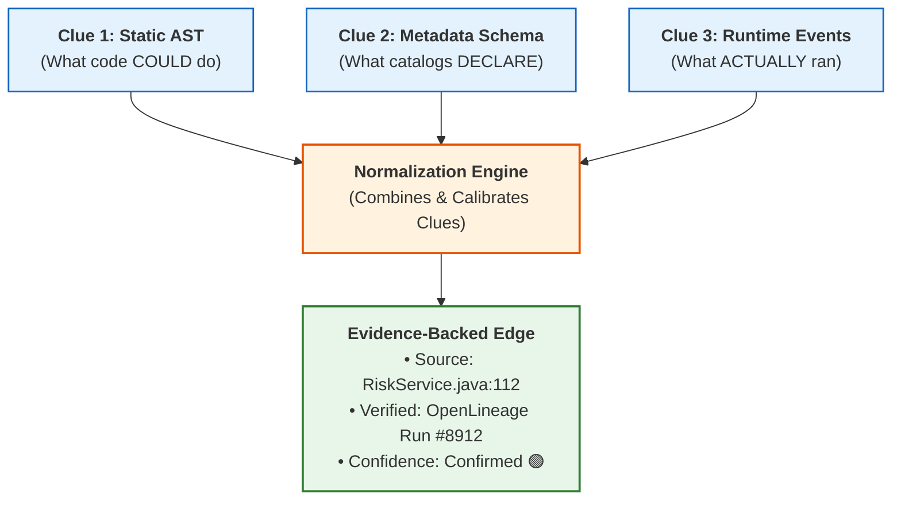
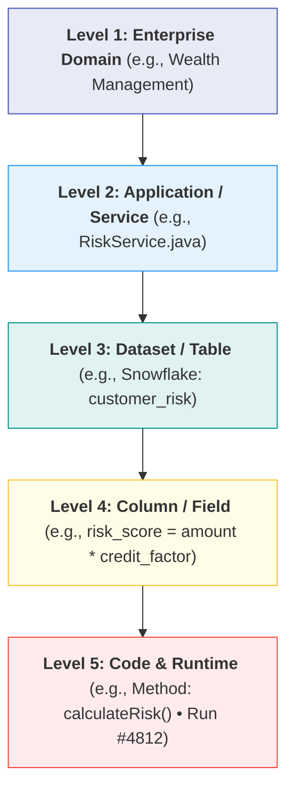
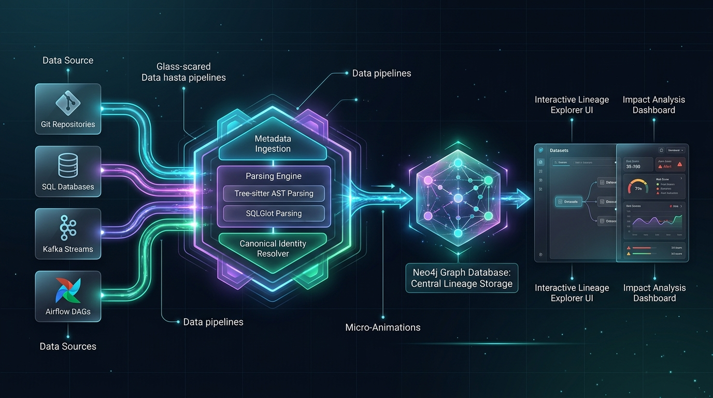
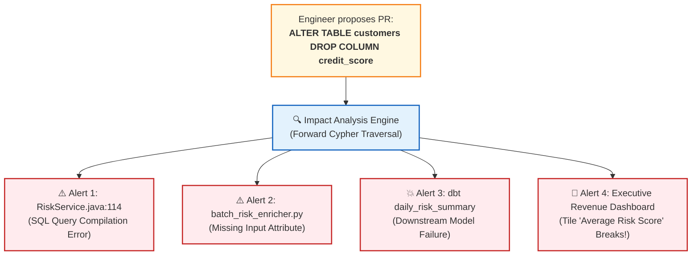
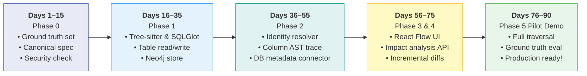

# Solving the Enterprise Data Mystery
### *The Story of How We Cracked Cross-System Data Lineage & Dependency Tracking*



> **Quick Navigation:**  
> 📖 **You are reading:** *The Story Mode & Executive Architecture Journey* (Intuitive, clue-by-clue overview).  
> 🔬 **Need the full technical reference?** Check out the exhaustive 1,000-line specification in [detailed_overview.md](detailed_overview.md) (Complete JSON schemas, Python interfaces, risk matrices, and glossary).

---

## The Plot: Table of Contents
1. [Prologue: The Monday Morning Crime Scene](#1-prologue-the-monday-morning-crime-scene)
2. [Act I: The 20 Suspects in the Enterprise Fog](#2-act-i-the-20-suspects-in-the-enterprise-fog)
3. [Act II: Collecting the Three Clues (The Evidence Planes)](#3-act-ii-collecting-the-three-clues-the-evidence-planes)
4. [Act III: Solving the Hardest Riddles](#4-act-iii-solving-the-hardest-riddles)
   - [Riddle 1: The Doppelgänger Trap (Dataset Identity)](#riddle-1-the-doppelgänger-trap-dataset-identity)
   - [Riddle 2: The 5 Layers of Reality](#riddle-2-the-5-layers-of-reality)
   - [Riddle 3: The Ghost Dependency (Control vs. Data Flow)](#riddle-3-the-ghost-dependency-control-vs-data-flow)
5. [Act IV: Assembling the Deduction Engine (System Architecture)](#5-act-iv-assembling-the-deduction-engine-system-architecture)
6. [Act V: Simulating the Crime (Automated Blast Radius)](#6-act-v-simulating-the-crime-automated-blast-radius)
7. [Act VI: The 90-Day Blueprint & The Final Verdict](#7-act-vi-the-90-day-blueprint--the-final-verdict)

---

# 1. Prologue: The Monday Morning Crime Scene

It is **09:00 AM on Monday**. The CFO opens the executive dashboard to prepare for the board meeting, and the main revenue KPI widget displays a catastrophic error:

$$\text{\textbf{500: Database Column Not Found}}$$

Alarms trigger across Slack. Teams scramble:
- The **BI Team** says: *"Our dashboard is untouched; the Snowflake warehouse table `daily_risk_summary` stopped receiving updates!"*
- The **Data Engineering Team** says: *"Our dbt pipeline failed because upstream table `risk_enriched_orders` had null values!"*
- The **Platform Team** says: *"The Python job failed because the backend Java service changed on Friday afternoon!"*
- The **Backend Engineer** says: *"I only renamed a variable in one method in a Java repository! How could that break an executive board dashboard four systems away?!"*



### The Real Problem
**Nobody had the full map.**  
In modern enterprises, code lives in GitHub, jobs live in Airflow, schemas live in databases, transformations live in dbt, and dashboards live in Power BI. 

**The Mission:** Build **Google Maps for Enterprise Data**—an intelligent platform that traces any data asset from source code to dashboard, explains *why* each connection exists, and predicts **what will break before changes are merged.**

---

# 2. Act I: The 20 Suspects in the Enterprise Fog

To solve this mystery, we first interrogated the typical suspects in the company:

```text
       THE 20 DISCONNECTED SUSPECTS ACROSS THE ESTATE
 ┌──────────────────────────────────────────────────────────┐
 │ • Java Microservices      • Python Analytics Scripts     │
 │ • PostgreSQL Databases    • Oracle Stored Procedures     │
 │ • Snowflake Warehouse     • Apache Kafka Event Topics    │
 │ • AWS S3 Data Lakes       • Apache Airflow DAGs          │
 │ • dbt Transformation Models • Power BI Dashboards        │
 └──────────────────────────────────────────────────────────┘
```

Why couldn't our existing tools solve this?

1. **Detective Git (Source Code Parsers):** Knows what the code *might* do, but has no clue what runs in production. It cannot see runtime SQL generated dynamically or database triggers.
2. **Detective Catalog (DataHub / OpenMetadata):** Knows table and column names, but stops at the database door. It cannot inspect the logic inside a Java method or calculate math inside a complex SQL CTE.
3. **Detective LLM (AI Models):** Hallucinates! When asked to map relationships across a 500,000-line codebase, it invents plausible-looking connections that do not exist.

> [!IMPORTANT]
> **The Epiphany:**  
> A single tool or AI model cannot solve this puzzle. We must construct a **Unified Lineage Fabric** that gathers forensic clues from three independent planes and binds them with auditable physical evidence.

---

# 3. Act II: Collecting the Three Clues (The Evidence Planes)

To build undeniable proof for every relationship, our detective engine collects **three distinct categories of clues**:



### Clue 1: The Static Breadcrumbs (Code & SQL AST)
*Found in Git repositories without executing anything.*
- **How we find it:** We deploy **Tree-sitter** to parse Java and Python into Abstract Syntax Trees (ASTs), and **SQLGlot** to parse SQL queries across dialects.
- **What it reveals:** Potential paths, method calls, and column transformation math (`salary * 0.10 AS bonus`).
- **Limitation:** Cannot guarantee whether an `if-else` branch actually ran in production.

### Clue 2: The Metadata Fingerprints (Schemas & Catalogs)
*Found in database information schemas, data catalogs, and orchestrator manifests.*
- **How we find it:** Read-only connectors query catalog APIs and database dictionaries (`information_schema.columns`, dbt `manifest.json`).
- **What it reveals:** Official table definitions, declared data types, and job ownership.
- **Limitation:** Lacks internal code transformations and stops at vendor boundaries.

### Clue 3: The Runtime Eyewitness (Telemetry & Logs)
*Found in live production execution telemetry.*
- **How we find it:** Ingesting **OpenLineage** runtime event payloads, database query audit logs, and distributed traces.
- **What it reveals:** Proves what datasets were *actually read and written* during an execution run at a specific timestamp.
- **Limitation:** Only covers observed runs during the retention window.



---

# 4. Act III: Solving the Hardest Riddles

### Riddle 1: The Doppelgänger Trap (Dataset Identity)
**The Puzzle:** In a global enterprise, we found five different tables named `CUSTOMERS`. Are they the same object?
- `DEV.CUSTOMERS`
- `STAGING.CUSTOMERS`
- `PROD.CUSTOMERS` (Snowflake US)
- `PROD.CUSTOMERS` (Postgres EU)

If we merge them blindly, our lineage graph becomes a tangled web of lies.

**The Solution: The 6-Tuple Canonical URI**  
We assign every dataset a deterministic global fingerprint:
$$\text{dataset://}\{\text{platform}\}/\{\text{tenant}\}/\{\text{environment}\}/\{\text{cluster}\}/\{\text{database}\}/\{\text{schema}\}/\{\text{table}\}$$

*Result: No more mistaken identities. Development tables never accidentally link to production dashboards.*

---

### Riddle 2: The 5 Layers of Reality
**The Puzzle:** Different users need different levels of detail. The CFO wants to see business domains; the engineer wants to see the exact line of code.

**The Solution:** An unbroken 5-layer zoom hierarchy:



---

### Riddle 3: The Ghost Dependency (Control vs. Data Flow)
**The Puzzle:** In Airflow, Task B runs after Task A (`Task A >> Task B`). Does data flow between them?  
**The Revelation:** Not necessarily! Task A might just be clearing a temporary lock or sending a Slack alert.  
**The Rule:** We strictly separate `DEPENDS_ON` (execution order) from `TRANSFORMS_TO` (data lineage). We never draw a data arrow unless bytes physically moved.

---

# 5. Act IV: Assembling the Deduction Engine (System Architecture)

With our clues and rules in place, we built the machine that continuously stitches the enterprise together:



### The 4 Engine Components:
1. **The Ingestion Net:** Connectors safely read Git commits, database schemas, and OpenLineage events using least-privilege access.
2. **The Compiler Core:** Tree-sitter and SQLGlot extract ASTs, trace CTE expressions, and unwrap dynamic aliases into normalized entities.
3. **The Brain (Neo4j + PostgreSQL):**
   - **Neo4j:** Traverses millions of interconnected dependencies across 8+ hops in milliseconds using Cypher.
   - **PostgreSQL:** Stores tenant settings, audit logs, run histories, and forensic proof cards.
4. **The Detective's UI (React Flow):** An interactive visual canvas that lets users click any node, expand upstream origins, inspect code evidence, and simulate downstream changes.

---

# 6. Act V: Simulating the Crime (Automated Blast Radius)

Remember our Monday morning crisis?  
With our deduction engine running, that crisis **can never happen again.**

Before any engineer merges code, they run an automated **Impact Analysis Simulation**:



### What the Engineer Sees in GitHub Pull Request:
```text
⚠️ BLAST RADIUS DETECTED: 4 Downstream Assets Affected!
-------------------------------------------------------------------------
• 1 Direct Breaking Change: RiskService.java (Class: RiskCalculator)
• 1 Broken Pipeline: batch_risk_enricher.py (Owner: Data Eng Team)
• 1 Failed Model: Snowflake dbt daily_risk_summary (Owner: Finance Analytics)
• 1 Impacted Dashboard: Executive Revenue Dashboard (Owner: VP Risk)
-------------------------------------------------------------------------
PR Blocked by Lineage Governance Gate until migration plan is provided.
```

The crime is prevented before it reaches production.

---

# 7. Act VI: The 90-Day Blueprint & The Final Verdict

How do we take this from concept to working enterprise reality? We don't try to build the universe on day one. We follow a strict **90-Day Focused Pilot**:



### What We Reuse vs. What We Build

| What We Reuse (Commodity Infrastructure) | What We Build (Our Proprietary Value) |
| :--- | :--- |
| • Syntax Parsing: **Tree-sitter** | • **Cross-System Evidence Engine** (3 Planes) |
| • SQL Dialects: **SQLGlot** | • **Canonical Identity Resolver** (6-Tuple URI) |
| • Event Schemas: **OpenLineage** | • **Code-to-Column Expression Tracer** |
| • Graph Engine: **Neo4j** | • **Blast-Radius Impact Analysis Engine** |
| • Relational Store: **PostgreSQL** | • **Incremental Git Reconciliation Engine** |
| • UI Canvas: **React Flow** | • **Evidence-Backed Trust & Coverage Dashboard** |

---

## The Final Verdict

Data lineage is not just a diagram tool, and it is not a data catalog clone.  
**It is an auditable evidence fabric that answers the fundamental question of enterprise data:**

> *"Where did this data originate, how was it transformed, who is using it right now, and what will break if I change it today?"*

---

### Interactive Web App & GitHub Repository

- 🌐 **Interactive Web Experience:** Open [`docs/index.html`](docs/index.html) to run the live Node & Edge Lineage Graph, interactive clue collection, and blast radius simulation.
- 📦 **GitHub Repository:** [https://github.com/TestAccount-04/datalineage.git](https://github.com/TestAccount-04/datalineage.git)
- 🚀 **Clone & Run:**
  ```bash
  git clone https://github.com/TestAccount-04/datalineage.git
  cd datalineage
  # Open docs/index.html in any browser, or enable GitHub Pages from /docs in repo settings!
  ```

---

### Ready for the Complete Technical Deep-Dive?
This story gives you the complete conceptual journey. To inspect the **full 1,000-line engineering blueprint**, including:
- Complete JSON schemas for evidence records and impact analysis
- Formal Pydantic Python interface for `BaseConnector`
- Detailed trade-off matrices for 20+ technologies
- 12 risk mitigations, FinOps token budgets, and 17 glossary terms

👉 **Read the full engineering blueprint in [detailed_overview.md](detailed_overview.md)**
