# Enterprise Data Lineage & Dataset Dependency Platform
> **The Definitive System Architecture, Implementation Blueprint & Engineering Guide**  
> *Transforming fragmented source code, metadata catalogs, and runtime telemetry into a unified, evidence-backed dependency fabric.*


---

## Table of Contents
1. [Executive Overview & Vision](#1-executive-overview--vision)
   - [What Are We Actually Building? ("Google Maps for Enterprise Data")](#11-what-are-we-actually-building-google-maps-for-enterprise-data)
   - [The Core Enterprise Problem: The Fragmented 20-Tool Estate](#12-the-core-enterprise-problem-the-fragmented-20-tool-estate)
   - [Core Platform Capabilities](#13-core-platform-capabilities)
2. [Target System Architecture](#2-target-system-architecture)
   - [6-Layer Architecture Blueprint](#21-6-layer-architecture-blueprint)
   - [The 3 Evidence Planes Fabric](#22-the-3-evidence-planes-fabric)
   - [Why Not Just DataHub? Why Not Just OpenLineage?](#23-why-not-just-datahub-why-not-just-openlineage)
3. [The 5 Levels of Enterprise Lineage](#3-the-5-levels-of-enterprise-lineage)
   - [Hierarchical Depth (Enterprise to Code & Runtime)](#31-hierarchical-depth-enterprise-to-code--runtime)
   - [Bidirectional Traversal: Upstream vs. Downstream](#32-bidirectional-traversal-upstream-vs-downstream)
4. [Canonical Data Model & Graph Schema](#4-canonical-data-model--graph-schema)
   - [Graph Entity-Relationship Architecture](#41-graph-entity-relationship-architecture)
   - [Core Node Types (12 Entities)](#42-core-node-types-12-entities)
   - [Core Relationship Types (13 Edges)](#43-core-relationship-types-13-edges)
   - [Canonical Dataset Identity (6-Tuple URI Hashing)](#44-canonical-dataset-identity-6-tuple-uri-hashing)
   - [The Evidence Record Schema (JSON Specification)](#45-the-evidence-record-schema-json-specification)
   - [Confidence & Trust Classification](#46-confidence--trust-classification)
5. [Engineering Deep-Dive: 12 Problems & Concrete Solutions](#5-engineering-deep-dive-12-problems--concrete-solutions)
   - [5.1 Multi-Language Source Code (Tree-sitter AST & Symbol Tables)](#51-multi-language-source-code-tree-sitter-ast--symbol-tables)
   - [5.2 SQL & Granular Column Lineage (SQLGlot & CTE Scopes)](#52-sql--granular-column-lineage-sqlglot--cte-scopes)
   - [5.3 Stored Procedures & Database-Side Logic](#53-stored-procedures--database-side-logic)
   - [5.4 ETL & Orchestration Pipelines (Airflow, dbt, Spark)](#54-etl--orchestration-pipelines-airflow-dbt-spark)
   - [5.5 APIs, Microservices & Kafka Event Streams](#55-apis-microservices--kafka-event-streams)
   - [5.6 BI & Semantic Layers (Tableau, PowerBI)](#56-bi--semantic-layers-tableau-powerbi)
   - [5.7 Runtime Transaction Lineage vs. Static Paths](#57-runtime-transaction-lineage-vs-static-paths)
   - [5.8 Cross-System Dataset Identity Resolution](#58-cross-system-dataset-identity-resolution)
   - [5.9 LLM Hallucination, Guardrails & Cost Containment](#59-llm-hallucination-guardrails--cost-containment)
   - [5.10 Change Impact Analysis Engine](#510-change-impact-analysis-engine)
   - [5.11 Scalability, Incremental Updates & Watermarking](#511-scalability-incremental-updates--watermarking)
   - [5.12 Enterprise Security, Secret Redaction & RBAC](#512-enterprise-security-secret-redaction--rbac)
6. [Technology Stack & Tooling Evaluation Matrix](#6-technology-stack--tooling-evaluation-matrix)
   - [Recommended Production Stack](#61-recommended-production-stack)
   - [Tooling Trade-offs & Verdicts](#62-tooling-trade-offs--verdicts)
   - [Why Neo4j? (Cypher Traversal Engine)](#63-why-neo4j-cypher-traversal-engine)
   - [The License & Commercial-Use Gate Checklist](#64-the-license--commercial-use-gate-checklist)
7. [Engine Internals: Extraction Pipeline & APIs](#7-engine-internals-extraction-pipeline--apis)
   - [Connector Framework Interface](#71-connector-framework-interface)
   - [10-Stage Sequential Ingestion Pipeline](#72-10-stage-sequential-ingestion-pipeline)
   - [Core REST API Specification](#73-core-rest-api-specification)
   - [User Interface Views Specification](#74-user-interface-views-specification)
8. [Real-World End-to-End Walkthrough](#8-real-world-end-to-end-walkthrough)
   - [Financial Risk Pipeline Architecture](#81-financial-risk-pipeline-architecture)
   - [Evidence Audit Trail Behind Each Edge](#82-evidence-audit-trail-behind-each-edge)
   - [Downstream Blast Radius: Dropping a Column](#83-downstream-blast-radius-dropping-a-column)
   - [Interactive Asset Dossier Preview (UI Output)](#84-interactive-asset-dossier-preview-ui-output)
9. [Delivery Roadmap & First 90 Days Pilot](#9-delivery-roadmap--first-90-days-pilot)
   - [7-Phase Delivery Timeline](#91-7-phase-delivery-timeline)
   - [90-Day Sprint Breakdown](#92-90-day-sprint-breakdown)
   - [Scope Discipline: What NOT to Build in V1](#93-scope-discipline-what-not-to-build-in-v1)
10. [FinOps & LLM Cost Strategy](#10-finops--llm-cost-strategy)
11. [Build vs. Reuse Intellectual Property Matrix](#11-build-vs-reuse-intellectual-property-matrix)
12. [Enterprise Risk Management Matrix](#12-enterprise-risk-management-matrix)
13. [Pilot Acceptance Criteria & Quality Metrics](#13-pilot-acceptance-criteria--quality-metrics)
14. [Comprehensive Glossary of Terms](#14-comprehensive-glossary-of-terms)

---

# 1. Executive Overview & Vision

## 1.1 What Are We Actually Building? ("Google Maps for Enterprise Data")

Think of this platform as **Google Maps for enterprise data estates**.

Google Maps knows how physical entities connect:
$$\text{Local Street A} \longrightarrow \text{Highway B} \longrightarrow \text{Bridge C} \longrightarrow \text{Destination D}$$

Our platform determines how enterprise data flows, mutates, and terminates:
$$\text{Code Method} \longrightarrow \text{Source Table} \longrightarrow \text{SQL AST} \longrightarrow \text{ETL Job} \longrightarrow \text{Warehouse Table} \longrightarrow \text{Column} \longrightarrow \text{BI Dashboard}$$

When an engineer, data architect, or auditor selects any asset (table, column, API, method, job, topic, or report), the platform answers:
1. **Upstream Origin:** Where did this data originate, and what transformations touched it?
2. **Downstream Flow:** Which applications, pipelines, reports, APIs, and ML models consume it?
3. **Change Blast Radius:** If I modify, rename, or drop this table/column today, **what breaks downstream?**
4. **Trustworthy Evidence:** *Why* do we believe this link exists? What is the physical proof, when was it last verified, and what remains unknown?

```mermaid
flowchart LR
    subgraph SRC["Enterprise Data Sources"]
        direction TB
        S1["Git Repositories (Java, Python)"]
        S2["SQL Databases (Postgres, Oracle)"]
        S3["Kafka Event Streams"]
        S4["Airflow DAGs & dbt Models"]
    end

    subgraph ING["Ingestion & Parsing Core"]
        direction TB
        P1["Metadata Ingestion"]
        P2["Tree-sitter AST & SQLGlot Parsing"]
        P3["Canonical Identity Resolver"]
    end

    subgraph STR["Central Lineage Storage"]
        direction TB
        G1[("Neo4j Graph Database<br/>(Topology & Multi-Hop)")]
        G2[("PostgreSQL State DB<br/>(Audit, Runs, Proofs)")]
    end

    subgraph UI["Consumption & Analytics"]
        direction TB
        U1["Interactive Lineage Explorer UI"]
        U2["Change Impact Analysis Dashboard"]
    end

    SRC --> ING --> STR --> UI

    classDef s fill:#e1f5fe,stroke:#0288d1,stroke-width:1.5px;
    classDef i fill:#ede7f6,stroke:#5e35b1,stroke-width:1.5px;
    classDef g fill:#e0f2f1,stroke:#00897b,stroke-width:1.5px;
    classDef u fill:#fff3e0,stroke:#f4511e,stroke-width:1.5px;

    class SRC,S1,S2,S3,S4 s;
    class ING,P1,P2,P3 i;
    class STR,G1,G2 g;
    class UI,U1,U2 u;
```

---

## 1.2 The Core Enterprise Problem: The Fragmented 20-Tool Estate

In modern enterprises, data flows through dozens of heterogeneous platforms. **No single tool or repository knows the complete dependency truth.**

```text
       ENTERPRISE TECHNOLOGY LANDSCAPE (FRAGMENTED REALITY)
 ┌──────────────────────────────────────────────────────────────┐
 │ Java Services │ Python Services │ Scala/Spark │ C#/.NET       │
 │ PostgreSQL    │ Oracle          │ SQL Server  │ Snowflake     │
 │ Apache Kafka  │ AWS S3 / ADLS   │ Airflow     │ dbt Core/Cloud│
 │ Informatica   │ Azure Data Fact │ Power BI    │ Tableau       │
 └──────────────────────────────┬───────────────────────────────┘
                                │
   EACH SYSTEM ONLY HOLDS ONE PIECE OF THE PUZZLE
   • Java Code:    "I read the CUSTOMERS table."
   • PostgreSQL:   "CUSTOMERS has 45 columns."
   • Airflow:      "I trigger a nightly batch job."
   • Snowflake:    "Query ID 98211 executed at 02:00 UTC."
   • dbt:          "Model daily_revenue depends on orders."
   • Power BI:     "Dashboard renders KPI from daily_revenue."
```

Traditional approaches fail:
- **Git-Only Parsers:** Miss dynamic SQL strings, ETL workflows, uncommitted DB triggers, and runtime execution paths.
- **Catalog-Only Tools (DataHub/OpenMetadata):** Stop at the table boundary; lack fine-grained column AST math, method-level code syntax, and runtime query execution context.
- **LLM-Only Guesswork:** Nondeterministic, expensive at enterprise scale, and hallucinates plausible-looking edges that do not exist in reality.

---

## 1.3 Core Platform Capabilities

| # | Capability | Operational Meaning |
| :---: | :--- | :--- |
| **1** | **Enterprise-to-Code Navigation** | Traverse unbroken from Domain $\rightarrow$ System $\rightarrow$ Pipeline $\rightarrow$ Dataset $\rightarrow$ Column $\rightarrow$ Code Symbol / Runtime Event. |
| **2** | **Bidirectional Traversal** | Start from any node and walk upstream (provenance) or downstream (consumers) with bounded depth. |
| **3** | **Fine-Grained Column Lineage** | Trace field-level transformations (`salary * 0.10 AS bonus`) with AST-level proof. |
| **4** | **3-Plane Evidence Separation** | Static code, catalog metadata, and runtime events are kept distinct and never conflated as equally certain. |
| **5** | **Automated Impact Analysis** | Instantly calculate the blast radius of schema or code changes before committing code to production. |
| **6** | **Evidence & Confidence Scores** | Every single edge displays its provenance: source file, line number, query ID, timestamp, and verification status. |
| **7** | **Explicit Coverage Gap Reporting** | Surfaces what is confirmed, inferred, stale, or blocked by permission failures—*never invents missing edges*. |
| **8** | **Incremental Reconciliation** | Uses Git commit diffs and database watermarks to re-parse only changed files, avoiding full-graph rebuilds. |
| **9** | **Zero-Trust Enterprise Governance** | Built-in credential redaction, tenant isolation, RBAC-filtered querying, and private VPC/air-gapped deployment. |

---

# 2. Target System Architecture

## 2.1 6-Layer Architecture Blueprint

Data flows sequentially through six distinct enterprise layers:

```mermaid
flowchart TD
    subgraph L1["1. Enterprise Systems (Sources of Truth)"]
        S1["Git Repositories (Java, Python, SQL)"]
        S2["Databases & Warehouses (Postgres, Snowflake)"]
        S3["ETL & Orchestration (Airflow, dbt, ADF)"]
        S4["Message Streams & APIs (Kafka, OpenAPI)"]
        S5["Catalogs & Query Logs (DataHub, Query History)"]
    end

    subgraph L2["2. Connector & Ingestion Layer"]
        C1["Git Collectors & Webhooks"]
        C2["Read-Only DB Metadata Connectors"]
        C3["OpenLineage Event Ingestion Sinks"]
        C4["Orchestration Manifest Parsers"]
    end

    subgraph L3["3. Extraction & Parsing Layer"]
        E1["Tree-sitter Language AST Adapters"]
        E2["SQLGlot Dialect Parser & CTE Scope Resolver"]
        E3["OpenAPI / Schema Registry Extractors"]
        E4["dbt manifest.json & Airflow DAG Parsers"]
    end

    subgraph L4["4. Normalization & Resolution Engine"]
        N1["Canonical Entity/Edge Schema"]
        N2["Dataset Identity Resolver (6-Tuple URI)"]
        N3["Evidence Registry & Confidence Calibrator"]
        N4["Rule Validation & Stale-Edge Detector"]
    end

    subgraph L5["5. Lineage Graph Storage Tier"]
        G1[("Neo4j Graph Store<br/>(Traversal & Topology)")]
        G2[("PostgreSQL State Store<br/>(Tenancy, Audit, Runs, Proofs)")]
        G3[("Search Index<br/>(PostgreSQL Full-Text / OpenSearch)")]
    end

    subgraph L6["6. Product & Consumption Tier"]
        P1["Interactive Lineage Explorer (React Flow)"]
        P2["Change Impact Analysis API"]
        P3["Column Lineage & Code Proof Inspector"]
        P4["Coverage Dashboard & Diagnostic Sinks"]
    end

    L1 --> L2 --> L3 --> L4 --> L5 --> L6

    classDef l1 fill:#e8eaf6,stroke:#3f51b5,stroke-width:2px;
    classDef l2 fill:#e3f2fd,stroke:#2196f3,stroke-width:2px;
    classDef l3 fill:#e0f2f1,stroke:#009688,stroke-width:2px;
    classDef l4 fill:#fff3e0,stroke:#ff9800,stroke-width:2px;
    classDef l5 fill:#fce4ec,stroke:#e91e63,stroke-width:2px;
    classDef l6 fill:#e8f5e9,stroke:#4caf50,stroke-width:2px;

    class L1,S1,S2,S3,S4,S5 l1;
    class L2,C1,C2,C3,C4 l2;
    class L3,E1,E2,E3,E4 l3;
    class L4,N1,N2,N3,N4 l4;
    class L5,G1,G2,G3 l5;
    class L6,P1,P2,P3,P4 l6;
```

---

## 2.2 The 3 Evidence Planes Fabric

Every connection in the graph is categorized into one of three independent evidence planes:

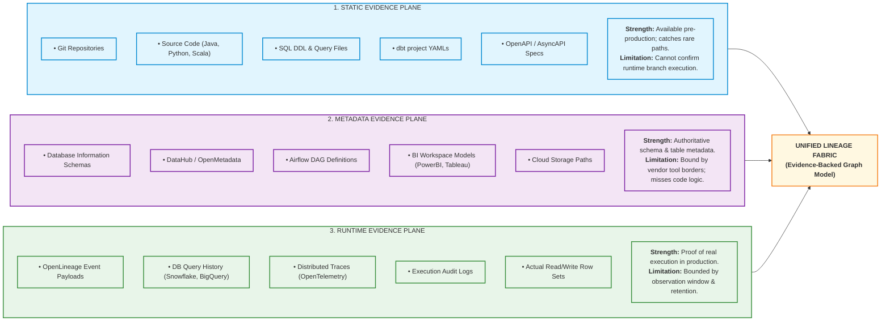

---

## 2.3 Why Not Just DataHub? Why Not Just OpenLineage?

| Solution | What It Does Well | Why It Is Not Sufficient Alone | Our Architecture's Approach |
| :--- | :--- | :--- | :--- |
| **DataHub / OpenMetadata** | Excellent enterprise metadata catalogs; surface owners, tags, glossary terms, and table schemas. | Designed as a catalog, not a deep code compiler. Cannot dissect Java methods, variables, or extract column AST math from nested CTEs. | **Ingest via Adapters:** We ingest existing catalog metadata without locking our core schema into their vendor format. |
| **OpenLineage** | Standardized JSON event specification for runtime job runs, task inputs, and task outputs. | Only captures instrumented jobs. Does not extract ASTs from uninstrumented code, resolve dynamic SQL, or handle cross-repo identities. | **Ingest as Event Input:** We consume OpenLineage as runtime telemetry into our normalization engine. |
| **LLMs (GPT-4 / Claude)** | Natural language explanation, summarizing complex pipelines, parsing unfamiliar legacy regex. | High cost, token limits, nondeterministic outputs, and high risk of **hallucinating false dependencies**. | **Constrained Gateway:** Restricted to candidate suggestions and explanations. The core engine works with LLMs disabled. |

---

# 3. The 5 Levels of Enterprise Lineage

## 3.1 Hierarchical Depth (Enterprise to Code & Runtime)

The platform provides unbroken zoom capability across 5 operational tiers:

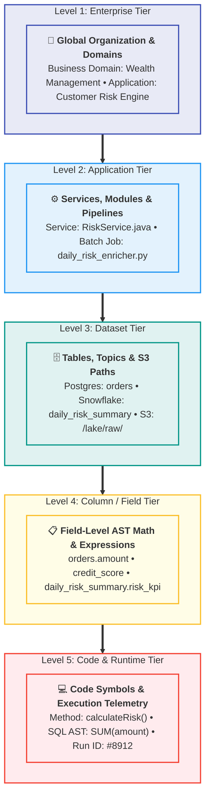

---

## 3.2 Bidirectional Traversal: Upstream vs. Downstream

Lineage must be traversable in both directions from any selected node:

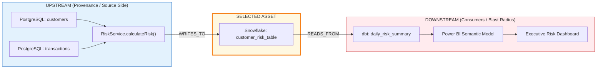

---

# 4. Canonical Data Model & Graph Schema

## 4.1 Graph Entity-Relationship Architecture

The internal graph uses an extensible, vendor-agnostic property graph schema:

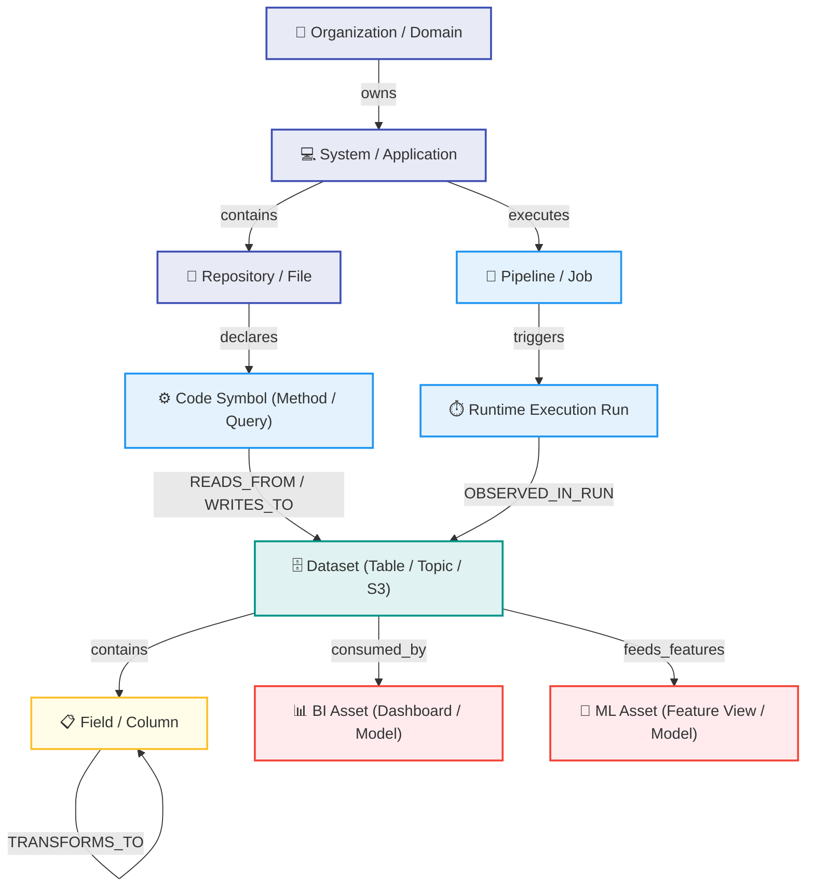

---

## 4.2 Core Node Types (12 Entities)

| Node Type | Description & Real-World Examples |
| :--- | :--- |
| **Organization / Domain** | Top-level business boundary: `Risk Management`, `Retail Banking`, `Corporate Finance`. |
| **System / Application** | Standalone service or software product: `BillingService`, `CustomerOnboarding`, `CoreBanking`. |
| **Repository / File** | Git repository and physical code file: `repo://github.com/corp/risk-engine`, `src/RiskService.java`. |
| **Code Symbol** | Syntactic code entity: Java `Class`, Python `def method()`, `variable`, SQL `SELECT` statement. |
| **Pipeline / Job / Task** | Orchestrated transformation unit: `Airflow DAG`, `dbt model`, `Spark job`, `ADF activity`. |
| **API Endpoint** | Communication interface: `REST GET /customers/{id}`, `GraphQL mutation createOrder`. |
| **Dataset** | Physical data container: Database `table`, `view`, Kafka `topic`, S3 `s3://bucket/prefix/`. |
| **Field / Column** | Atomic attribute: Table `column`, JSON `attribute`, Kafka Avro `event_field`. |
| **BI Asset** | Reporting asset: Power BI `Semantic Model`, Tableau `Dashboard`, Looker `Explore`. |
| **ML Asset** | Machine learning artifact: Feature Store `FeatureView`, training `Dataset`, `Model Endpoint`. |
| **Runtime Run** | Temporal execution instance: Airflow `Run #4812`, Snowflake `Query ID 9821`, Trace `trace_id`. |
| **Business Rule** | Assertion or constraint: Great Expectations `check_salary_positive`, Data Contract `v1`. |

---

## 4.3 Core Relationship Types (13 Edges)

| Edge Type | Semantic Meaning | Example Usage |
| :--- | :--- | :--- |
| `CONTAINS` | Structural parent-child containment | Repository $\rightarrow$ File; Database Schema $\rightarrow$ Table. |
| `DECLARES` | Code symbol declaration | Java File $\rightarrow$ Class $\rightarrow$ Method. |
| `CALLS` | Procedural invocation | Method A $\rightarrow$ Method B. |
| `READS_FROM` | Data ingestion / read operation | Method or Job $\rightarrow$ Dataset (Input). |
| `WRITES_TO` | Data egress / write operation | Method or Job $\rightarrow$ Dataset (Output). |
| `TRANSFORMS_TO` | Column-level data derivation | Source Column $\rightarrow$ Destination Column. |
| `DEPENDS_ON` | Control-flow execution ordering | Airflow Task B $\rightarrow$ Task A (*does not imply data flow*). |
| `CALLS_API` | Cross-service HTTP invocation | Service A $\rightarrow$ REST Endpoint B. |
| `PUBLISHES_TO` | Event production | Microservice $\rightarrow$ Kafka Topic. |
| `CONSUMES_FROM` | Event consumption | Kafka Consumer $\rightarrow$ Kafka Topic. |
| `CONSUMES` | Downstream reporting consumption | Power BI Dashboard $\rightarrow$ Snowflake Warehouse Table. |
| `OBSERVED_IN_RUN`| Temporal execution binding | Edge witnessed in Run `#8412` on `2026-10-10`. |
| `RESOLVES_TO` | Alias and identity binding | Alias `SALES.ORDERS` $\rightarrow$ Canonical `dataset://snowflake/prod/sales/orders`. |

> [!WARNING]
> **Control-Flow Dependency $\neq$ Data Lineage:** If Airflow Task B is scheduled to execute after Task A, that is a `DEPENDS_ON` control relationship. It is **never** recorded as a data lineage edge unless Task B physically consumes data produced by Task A.

---

## 4.4 Canonical Dataset Identity (6-Tuple URI Hashing)

Enterprises frequently have identical table names across environments (`DEV`, `STAGING`, `PROD`) and databases. To prevent catastrophic identity collisions, all physical data objects are resolved into a **deterministic 6-tuple canonical URI**:

$$\text{Canonical URI} = \text{dataset://}\{\text{platform}\}/\{\text{tenant}\}/\{\text{environment}\}/\{\text{cluster}\}/\{\text{database}\}/\{\text{schema}\}/\{\text{table}\}$$

```text
Examples:
• dataset://snowflake/corp_risk/prod/us-east-1/dw_finance/analytics/daily_revenue
• dataset://postgresql/retail/staging/cluster_02/sales_db/public/orders
• dataset://kafka/payments/prod/global/payment_events_v2
```

Fuzzy matching is strictly disallowed for production merges. Discovered aliases are stored as reviewable `Candidate` proposals.

---

## 4.5 The Evidence Record Schema (JSON Specification)

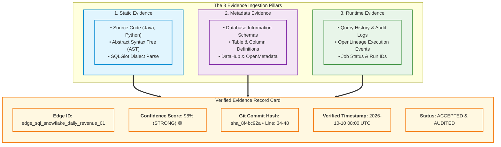

Every edge in the graph carries auditable proof:

```json
{
  "edge_id": "edge_sql_snowflake_daily_revenue_01",
  "source_entity_id": "dataset://snowflake/corp/prod/dw/analytics/orders",
  "target_entity_id": "dataset://snowflake/corp/prod/dw/analytics/daily_revenue",
  "relationship_type": "TRANSFORMS_TO",
  "evidence_plane": "static",
  "evidence_type": "ast_sql_parse",
  "source_system": "dbt_core",
  "source_location": "models/marts/finance/daily_revenue.sql:34-48",
  "source_version": "git:sha_8f4bc92a",
  "observed_at": null,
  "valid_from": "2026-10-10T08:00:00Z",
  "valid_to": null,
  "confidence_score": 0.98,
  "confidence_class": "STRONG",
  "verification_status": "ACCEPTED",
  "details": {
    "dialect": "snowflake",
    "parser": "SQLGlot 23.0",
    "ast_transformation": "SUM(orders.amount) AS revenue GROUP BY order_date",
    "joins_involved": ["orders.customer_id = customers.id"]
  }
}
```

---

## 4.6 Confidence & Trust Classification

| Confidence Band | Badge | Operational Meaning | Validation Criteria |
| :--- | :---: | :--- | :--- |
| **Confirmed** | `🟢` | **Authoritative Proof** | Validated via active runtime event (OpenLineage) or execution query log in the observation window. |
| **Strong** | `🟡` | **Deterministic Parse** | Extracted via deterministic AST parse (Tree-sitter / SQLGlot) with verified schemas and matching canonical IDs. |
| **Probable** | `🟠` | **Inferred Derivation** | Derived through framework naming conventions, dbt macros, or known wrapper functions. |
| **Candidate** | `⚪` | **Review Required** | Suggested via fuzzy string similarity or LLM semantic mapping. Awaiting human approval. |
| **Unknown** | `🔴` | **Coverage Gap** | Unresolved dynamic SQL, unparsed proprietary DSL, or permission failure. Displayed on Coverage Dashboard. |

---

# 5. Engineering Deep-Dive: 12 Problems & Concrete Solutions

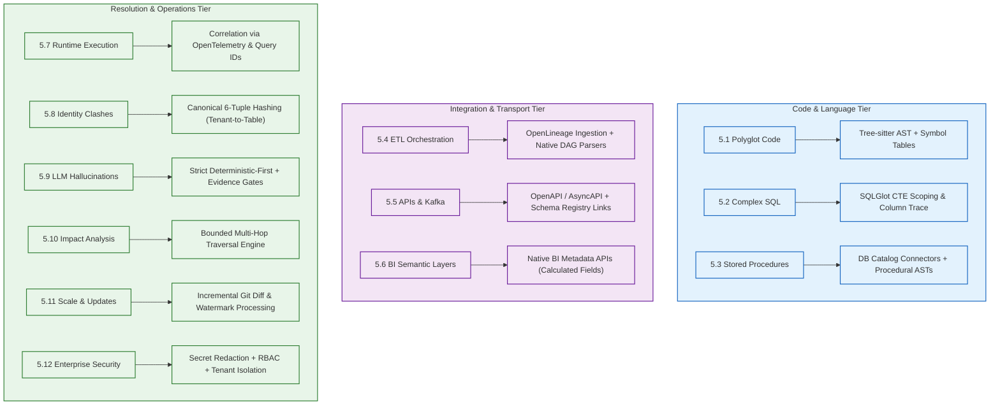

### 5.1 Multi-Language Source Code (Tree-sitter AST & Symbol Tables)
- **Problem:** Enterprise repositories mix Java, Python, Scala, C#, SQL, shell scripts, and proprietary DSLs.
- **Solution:** Standardize on **Tree-sitter** for multi-language concrete syntax trees (CST/AST). Custom language analyzers inspect framework sinks (`JdbcTemplate.query()`, `spark.read.parquet()`, `psycopg2.execute()`, `KafkaProducer.send()`). Variable scopes are traced from method parameters to database invocations. Dynamic calls that cannot be resolved statically are tagged `UNKNOWN_CALL`, never fabricated.

### 5.2 SQL & Granular Column Lineage (SQLGlot & CTE Scopes)
- **Problem:** Real SQL contains nested Common Table Expressions (CTEs), window functions, correlated subqueries, `CASE` statements, and `MERGE` clauses.
- **Solution:** Deploy **SQLGlot** as the core multi-dialect SQL compiler. The column resolution engine recursively unwraps CTE aliases down to physical base tables:
  ```text
  WITH raw_orders AS (SELECT id, amount, cust_id FROM source_orders),
       scored_orders AS (SELECT id, amount * 0.10 AS tax FROM raw_orders)
  SELECT id, tax FROM scored_orders;
  
  Column Lineage Trace:
  source_orders.amount ──[amount * 0.10]──> scored_orders.tax ──────> final.tax
  ```
  Indirect dependencies (columns used exclusively in `WHERE`, `JOIN`, or `GROUP BY` clauses) are preserved as `INDIRECT_DERIVATION` edges.

### 5.3 Stored Procedures & Database-Side Logic
- **Problem:** Critical business logic is locked inside Oracle PL/SQL, MS T-SQL, and PostgreSQL stored procedures.
- **Solution:** Connectors extract procedure definitions using read-only catalog views (`pg_proc`, `ALL_SOURCE`). Parse procedure bodies for embedded DML operations (`INSERT INTO ... SELECT`). Runtime execution frequency is cross-validated against query history (`sys.dm_exec_query_stats`, `pg_stat_statements`).

### 5.4 ETL & Orchestration Pipelines (Airflow, dbt, Spark)
- **Problem:** Orchestrators represent task execution sequence, not actual dataset movement.
- **Solution:** Ingest dbt `manifest.json` directly (provides 100% deterministic model-to-table lineage). For Airflow and Spark, ingest **OpenLineage** runtime event payloads emitting dataset read/write facets. Distinguish `DEPENDS_ON` (DAG scheduling) from `TRANSFORMS_TO` (data lineage).

### 5.5 APIs, Microservices & Kafka Event Streams
- **Problem:** Data moves across HTTP REST endpoints or Kafka topics without direct database connections.
- **Solution:** Parse OpenAPI/AsyncAPI specifications and HTTP client calls. Connect Kafka producer services to consumer services using Schema Registry Avro/JSON schemas. Model topics and endpoints as explicit intermediate vertices in the graph:
  $$\text{OrderService} \xrightarrow{\text{PUBLISHES}} \text{Topic: orders.v1} \xrightarrow{\text{CONSUMES}} \text{FulfillmentService}$$

### 5.6 BI & Semantic Layers (Tableau, PowerBI)
- **Problem:** Lineage breaks at the reporting boundary; calculated metrics and DAX formulas are invisible to backend data engineers.
- **Solution:** Ingest BI project definitions and metadata APIs. Map:
  $$\text{Warehouse Table} \longrightarrow \text{Semantic Model} \longrightarrow \text{Calculated Measure} \longrightarrow \text{Dashboard Sheet} \longrightarrow \text{Report Tile}$$

### 5.7 Runtime Transaction Lineage vs. Static Paths
- **Problem:** Static code shows all possible execution paths; runtime telemetry shows only what executed in a specific window.
- **Solution:** Stamp edges with an `observation_window`. Bind OpenLineage run IDs, query IDs, and OpenTelemetry trace IDs to static nodes.

### 5.8 Cross-System Dataset Identity Resolution
- **Problem:** Different platforms refer to the same physical asset differently (`prod.sales.orders` vs. `SALES.ORDERS`).
- **Solution:** Apply the 6-tuple canonical URI hashing scheme. Provide a human-in-the-loop review queue for candidate links. Never auto-merge high-impact production assets based solely on string fuzzy matching.

### 5.9 LLM Hallucination, Guardrails & Cost Containment
- **Problem:** LLMs invent plausible-looking connections and incur massive token costs when parsing large code repositories.
- **Solution:**
  - LLMs are **never** used for syntax or table discovery.
  - Used exclusively for natural-language lineage path explanations, legacy regex classifications, and candidate alias proposals.
  - LLM output must strictly conform to a Pydantic schema referencing existing node IDs. Any proposed edge that references a non-existent entity is discarded.
  - **The engine operates 100% deterministically with LLMs disabled.**

### 5.10 Change Impact Analysis Engine
- **Problem:** Developers modify code or schemas without knowing what downstream systems will break.
- **Solution:** Forward graph traversal with bounded depth. Distinguishes direct breaking schema changes (e.g., dropping a referenced column) from transitive downstream dependencies (e.g., an executive KPI dashboard 4 hops away).

### 5.11 Scalability, Incremental Updates & Watermarking
- **Problem:** Reprocessing 1,000 repositories and millions of tables on every commit is slow and expensive.
- **Solution:** Commit diffing triggers extraction only for modified files and their affected symbol neighborhoods. Database connectors utilize watermarks (`schema_version`, CDC logs). Graph updates are idempotent and reversible.

### 5.12 Enterprise Security, Secret Redaction & RBAC
- **Problem:** Source code and query logs contain database credentials, customer PII, and proprietary business logic.
- **Solution:** Regex and entropy-based secret scrubbing prior to graph ingestion. Strict tenant isolation, role-based access control (RBAC) on query APIs, and support for on-premises / air-gapped private VPC deployments.

---

# 6. Technology Stack & Tooling Evaluation Matrix

## 6.1 Recommended Production Stack

| Component | Recommended Technology | Primary Function | Why It Was Chosen |
| :--- | :--- | :--- | :--- |
| **Code Parser** | **Tree-sitter** | Multi-language AST parsing | Fast, resilient, error-tolerant CST/AST parser across 30+ languages. |
| **SQL Engine** | **SQLGlot** | SQL AST & column lineage | Multi-dialect parsing, transpilation, and scope resolution natively in Python. |
| **Runtime Events**| **OpenLineage** | Standard event ingestion | De-facto industry standard for Spark, Airflow, and Flink runtime telemetry. |
| **Catalogs** | **DataHub & OpenMetadata** | Existing catalog sync | Bi-directional connector adapters; reuses existing enterprise investments. |
| **Graph Store** | **Neo4j** | Traversal & topology engine | Native property graph with fast multi-hop Cypher queries. |
| **State Store** | **PostgreSQL** | Tenancy, audit & metadata | ACID transactions, connector job watermarks, run logs, and configuration state. |
| **Search Engine**| **PostgreSQL Full-Text** | Asset search & discovery | Simple, zero-dependency search for MVP; upgrade to OpenSearch as scale demands. |
| **API Backend** | **FastAPI (Python)** | Asynchronous REST service | High-performance async Python framework aligned with data engineering tooling. |
| **UI Canvas** | **React Flow** | Interactive lineage canvas | Highly performant React canvas with node expand/collapse, zoom, and custom edge badges. |
| **AI Gateway** | **Gated LLM Gateway** | Candidate suggestions & text | Strictly optional; enforces token budgets, caching, and deterministic fallbacks. |

---

## 6.2 Tooling Trade-offs & Verdicts

| Tool Category | Evaluated Alternatives | Advantages | Disadvantages | Final Architecture Verdict |
| :--- | :--- | :--- | :--- | :--- |
| **Code Parsing** | **Tree-sitter** vs. Native ASTs (`ast`, Java JDT) vs. LLM | Tree-sitter is universal and error-tolerant. | Requires custom query logic for deep semantic resolution. | **Tree-sitter as primary base;** use Java JDT / Python `ast` only where deep compiler semantics are required. |
| **SQL Parsing** | **SQLGlot** vs. OpenLineage SQL vs. Regex | SQLGlot supports 20+ dialects and CTE scope walking. | Vendor procedural SQL (PL/SQL) requires custom extensions. | **SQLGlot is mandatory.** Regex parsers are strictly prohibited for production. |
| **Graph Storage**| **Neo4j** vs. PostgreSQL Recursive CTEs vs. Apache AGE | Neo4j handles 10+ hop queries in milliseconds. | Community Edition requires careful license compliance. | **Neo4j for graph traversals + PostgreSQL for relational state.** |
| **UI Graph** | **React Flow** vs. Cytoscape.js vs. D3.js | React Flow provides an out-of-the-box modern React component model. | Very large graphs (10k+ nodes) require subgraph virtualization. | **React Flow for the interactive explorer;** Cytoscape.js for dense analytical views. |
| **Queues** | **Redis / Celery** vs. Apache Kafka | Lightweight, easy to deploy for MVP connector scheduling. | Lower throughput than Kafka for multi-terabyte log streams. | **Start with Redis/Celery;** introduce Kafka only if real-time query stream ingestion warrants it. |

---

## 6.3 Why Neo4j? (Cypher Traversal Engine)

Relational databases struggle with unbounded recursive joins across multi-hop dependencies. In Neo4j, traversing an 8-hop blast radius across thousands of nodes takes milliseconds using clean Cypher queries:

```cypher
// Trace downstream impact of a modified column up to 8 hops away
MATCH path = (c:Field {canonical_id: "snowflake://prod/analytics/customers/credit_score"})
             -[:TRANSFORMS_TO|READS_FROM|CONSUMES*1..8]->(downstream)
RETURN path, downstream.name, downstream.type, downstream.owner;
```

---

## 6.4 The License & Commercial-Use Gate Checklist

Before embedding any open-source dependency into commercial distributions:
1. **Repository Origin:** Verify canonical source repository and exact tag version.
2. **License Review:** Check license type (Apache 2.0 and MIT are safe; GPL/AGPL or BSL require legal review).
3. **Transitive Audit:** Run an automated Software Bill of Materials (SBOM) scanner to catch transitive license traps.
4. **Attribution & Notices:** Maintain a dedicated `NOTICES.txt` including all required copyright statements.
5. **No Hosted Trademark Violations:** Ensure naming does not infringe on registered commercial trademarks.

---

# 7. Engine Internals: Extraction Pipeline & APIs

## 7.1 Connector Framework Interface

Every connector implements a standardized lifecycle interface:

```python
class BaseConnector(ABC):
    @abstractmethod
    def discover_assets(self) -> list[DiscoveredAsset]:
        """Enumerate all available repositories, schemas, DAGs, or topics."""
        pass

    @abstractmethod
    def extract_metadata(self, asset: DiscoveredAsset) -> AssetMetadata:
        """Fetch structural schemas, descriptions, and ownership."""
        pass

    @abstractmethod
    def extract_definitions(self, asset: DiscoveredAsset) -> AssetDefinition:
        """Acquire raw source code, SQL DDL, or DAG configuration."""
        pass

    @abstractmethod
    def extract_lineage(self, asset: DiscoveredAsset) -> list[CanonicalEdge]:
        """Parse ASTs and output deterministic dependency edges."""
        pass

    @abstractmethod
    def extract_runtime_events(self, window: TimeWindow) -> list[RuntimeEvent]:
        """Ingest query history logs or OpenLineage execution facets."""
        pass

    @abstractmethod
    def checkpoint(self) -> ConnectorWatermark:
        """Persist extraction state and high-watermark timestamps."""
        pass

    @abstractmethod
    def health_check(self) -> ConnectorHealth:
        """Report connectivity, credentials status, and permissions."""
        pass
```

---

## 7.2 10-Stage Sequential Ingestion Pipeline

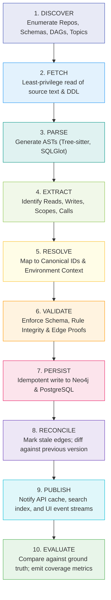

---

## 7.3 Core REST API Specification

| Method & Route | Purpose | Key Query Parameters |
| :--- | :--- | :--- |
| `GET /api/v1/assets/{id}` | Retrieve asset identity, metadata, schema, and owner. | `include_aliases=true` |
| `GET /api/v1/assets/{id}/upstream` | Fetch upstream provenance graph up to $N$ hops. | `depth=3&min_confidence=STRONG` |
| `GET /api/v1/assets/{id}/downstream` | Fetch downstream consumer graph up to $N$ hops. | `depth=5&environment=prod` |
| `GET /api/v1/assets/{id}/column-lineage` | Retrieve column-level mapping matrix and AST expressions. | `column=credit_score` |
| `GET /api/v1/impact` | Calculate downstream blast radius of a proposed change. | `entity_id={id}&change_type=DROP_COLUMN` |
| `GET /api/v1/evidence/{edge_id}` | Retrieve the auditable proof record for a specific edge. | `include_code_snippet=true` |
| `GET /api/v1/coverage` | Fetch system coverage metrics and diagnostic gap reports. | `system_id={id}` |
| `POST /api/v1/connectors/{id}/sync` | Trigger an incremental extraction job for a connector. | `dry_run=false` |
| `GET /api/v1/changes` | Review historical graph modifications within a time range. | `since=2026-10-01T00:00:00Z` |

---

## 7.4 User Interface Views Specification

1. **Enterprise Map:** High-level view showing relationships between domains, services, data warehouses, and BI workspaces.
2. **Application Architecture View:** Code repositories, microservices, internal classes, methods, and database connections.
3. **Dataset Lineage Canvas:** Table-level interactive directed graph with expandable upstream and downstream nodes.
4. **Column Lineage Matrix:** Field-to-field transformation view detailing mathematical expressions and intermediate aliases.
5. **Code Proof Inspector:** Side-by-side drawer displaying the physical file, line numbers, and highlighted SQL/Java snippet.
6. **Runtime Telemetry View:** Execution run history showing exact execution timestamps, run IDs, and byte volumes read/written.
7. **Change Impact Visualizer:** Color-coded blast radius overlay categorizing downstream breaks into `Direct Breaking` vs `Transitive Risk`.
8. **Coverage & Diagnostic Dashboard:** Displays overall extraction success rates, unparsed files, permission denials, and unknown edges.

---

# 8. Real-World End-to-End Walkthrough

## 8.1 Financial Risk Pipeline Architecture

Consider a real enterprise financial pipeline moving customer data across multiple technology stacks:

```mermaid
flowchart LR
    subgraph S_POSTGRES["PostgreSQL (OLTP)"]
        T1["orders<br/>(id, cust_id, amount)"]
        T2["customers<br/>(id, credit_score, email)"]
    end

    subgraph S_JAVA["Java Microservice (Risk Engine)"]
        M1["RiskService.calculateScore()<br/>• Static AST: Tree-sitter<br/>• File: RiskService.java:112"]
    end

    subgraph S_PYTHON["Scheduled Python Pipeline"]
        P1["batch_risk_enricher.py<br/>• Writes: risk_enriched_orders<br/>• Runtime: OpenLineage Run #4812"]
    end

    subgraph S_SNOWFLAKE["Snowflake Data Warehouse"]
        D1["dbt: daily_risk_summary<br/>• SQLGlot Dialect Parse<br/>• CTE Aggregate Logic"]
    end

    subgraph S_BI["Executive BI Layer"]
        B1["Semantic Model: RiskMetrics"]
        B2["Executive Risk Dashboard<br/>• Visualizes: risk_category"]
    end

    T1 & T2 -->|READS_FROM| M1
    M1 -->|TRANSFORMS_TO| P1
    P1 -->|WRITES_TO| D1
    D1 -->|FEEDS| B1
    B1 -->|RENDERS| B2

    classDef pg fill:#e3f2fd,stroke:#1565c0,stroke-width:1.5px;
    classDef jv fill:#f3e5f5,stroke:#7b1fa2,stroke-width:1.5px;
    classDef py fill:#e8f5e9,stroke:#2e7d32,stroke-width:1.5px;
    classDef sf fill:#e0f7fa,stroke:#00838f,stroke-width:1.5px;
    classDef bi fill:#fff3e0,stroke:#e65100,stroke-width:1.5px;

    class S_POSTGRES,T1,T2 pg;
    class S_JAVA,M1 jv;
    class S_PYTHON,P1 py;
    class S_SNOWFLAKE,D1 sf;
    class S_BI,B1,B2 bi;
```

---

## 8.2 Evidence Audit Trail Behind Each Edge

| Traversal Hop | Edge Type | Supporting Evidence | Confidence |
| :--- | :---: | :--- | :---: |
| `customers` $\rightarrow$ `RiskService.calculateScore()` | `READS_FROM` | Tree-sitter AST parse of `RiskService.java:112-140` identifying SQL query string. | **Strong (0.95)** |
| `RiskService` $\rightarrow$ `risk_enriched_orders` | `TRANSFORMS_TO` | OpenLineage run facet from `batch_risk_enricher.py` + Git commit hash `sha_109c2`. | **Confirmed (0.99)** |
| `risk_enriched_orders` $\rightarrow$ `daily_risk_summary` | `WRITES_TO` | dbt `manifest.json` model definition + SQLGlot dialect AST parsing. | **Strong (0.98)** |
| `daily_risk_summary` $\rightarrow$ `Executive Dashboard` | `CONSUMES` | Power BI REST API reading dataset bindings and visual card DAX expressions. | **Strong (0.96)** |

---

## 8.3 Downstream Blast Radius: Dropping a Column

When an engineer issues `ALTER TABLE customers DROP COLUMN credit_score`, the impact engine traverses forward to determine the blast radius:

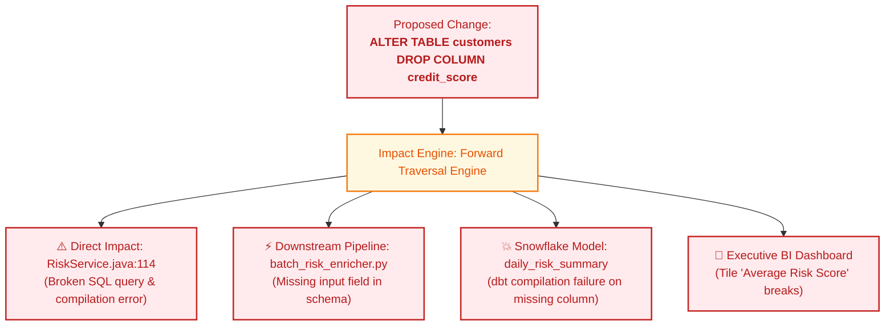

---

## 8.4 Interactive Asset Dossier Preview (UI Output)

```text
┌────────────────────────────────────────────────────────────────────────────────────────┐
│  DATASET: snowflake://prod/analytics/daily_risk_summary                                 │
│  Owner: Finance Data Team   |   Freshness: 12m ago   |   Trust Score: 98% (Strong)     │
├────────────────────────────────────────────────────────────────────────────────────────┤
│                                                                                        │
│  [ UPSTREAM LINEAGE ]                                                                  │
│  ◄── orders (Snowflake table)                                                          │
│      └── Evidence: models/marts/finance/daily_risk_summary.sql:34                      │
│  ◄── RiskService.calculateScore() (Java Service)                                       │
│      └── Evidence: src/main/java/com/corp/risk/RiskService.java:112                    │
│                                                                                        │
│  [ DOWNSTREAM IMPACT ]                                                                 │
│  ──► Executive Risk KPI Dashboard (Power BI)                                           │
│      └── Owner: VP Risk | Direct Dependent: risk_category_kpi                           │
│                                                                                        │
│  [ COLUMN MAPPING & PROOF ]                                                            │
│  • daily_risk_summary.risk_score <── SUM(orders.amount) * credit_multiplier             │
│    ├── Source AST: SQLGlot Dialect AST (Snowflake)                                     │
│    └── Verified In Run: OpenLineage Run #8912 (2026-10-10 11:45 UTC)                    │
│                                                                                        │
│  [ COVERAGE & DIAGNOSTICS ]                                                            │
│  • Verified Evidence: Static AST (98%) + OpenLineage Runtime (Confirmed)               │
│  • Unknowns / Blocked: 0 issues detected                                               │
└────────────────────────────────────────────────────────────────────────────────────────┘
```

---

# 9. Delivery Roadmap & First 90 Days Pilot

## 9.1 7-Phase Delivery Timeline

```mermaid
gantt
    title Enterprise Lineage Platform Delivery Plan
    dateFormat  YYYY-MM-DD
    section Pilot (First 90 Days)
    Phase 0: Scope & Ground Truth Set       :active, p0, 2026-10-15, 7d
    Phase 1: Code & SQL Parser Prototype    :p1, after p0, 21d
    Phase 2: Identity & Evidence Registry   :p2, after p1, 14d
    Phase 3: Column Lineage & Metadata      :p3, after p2, 21d
    Phase 4: Cross-System & Impact UI       :p4, after p3, 21d
    section Hardening & Expansion
    Phase 5: Pilot Hardening & Security     :p5, after p4, 60d
    Phase 6: Multi-Tenant Enterprise Scale  :p6, after p5, 180d
```

| Phase | Timing | Deliverables & Scope | Exit Criteria |
| :--- | :---: | :--- | :--- |
| **Phase 0: Scope & Ground Truth** | Week 1 | Select 1 code repo, 1 database, 1 orchestrator. Curate 20–50 verified lineage ground truth links. | Bounded pilot with explicit non-goals. |
| **Phase 1: Code & SQL Prototype** | Weeks 2–4 | Ingest repos; Tree-sitter parser; SQLGlot dialect ASTs; basic Neo4j property graph. | Trace tables to code that reads/writes them. |
| **Phase 2: Identity & Evidence** | Weeks 5–6 | Implement canonical 6-tuple IDs; build evidence store; stale edge reconciliation. | Duplicate names across envs never merge. |
| **Phase 3: Column Lineage & DB** | Weeks 7–9 | Nested CTE scope resolution; column-level math mappings; 1 read-only DB connector. | Column lineage works for documented SQL subset. |
| **Phase 4: Cross-System & Impact** | Weeks 10–12 | Link code $\rightarrow$ job $\rightarrow$ table $\rightarrow$ BI; downstream impact API; React Flow UI explorer. | Complete end-to-end traversal across 2+ systems. |
| **Phase 5: Pilot Hardening** | Months 4–5 | RBAC; credential scrubbing; audit logging; retry queues; automated regression tests. | Pilot team uses platform without manual rebuilds. |
| **Phase 6: Enterprise Expansion** | Months 6–12+ | Multi-tenant controls; high availability; Kafka stream connectors; catalog bi-directional sync. | SLAs established; operational handover complete. |

---

## 9.2 90-Day Sprint Breakdown

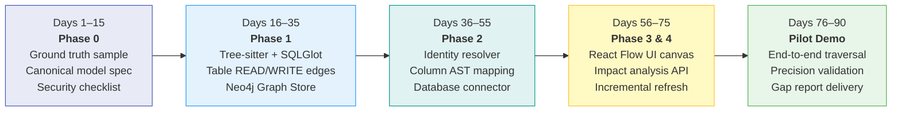

---

## 9.3 Scope Discipline: What NOT to Build in V1

To guarantee delivery within 90 days, **do not attempt the following in V1**:
- ❌ Do not support 50+ programming languages (focus strictly on Java, Python, and SQL).
- ❌ Do not build custom parsers for every ETL vendor (use dbt `manifest.json` and OpenLineage).
- ❌ Do not attempt universal transaction-level tracing for all production requests.
- ❌ Do not attempt full-repo LLM scanning.
- ❌ Do not attempt unconstrained fuzzy merging of dataset names.

---

# 10. FinOps & LLM Cost Strategy

| Strategy Area | Implementation Rule | Operational Impact |
| :--- | :--- | :--- |
| **Keep Deterministic Work Free** | Parse code locally using Tree-sitter and SQLGlot. Cache AST hashes. | Eliminates unnecessary LLM API calls on 99% of codebase. |
| **Incremental Caching** | Cache ASTs and extraction outputs by file SHA-256 content hashes. | Reprocesses only modified lines of code. |
| **Targeted LLM Invocation** | Send small snippets (under 200 tokens) strictly when encountering unparsed dynamic wrappers. | Prevents runaway token bills. |
| **Structured Output Validation**| LLMs must return valid JSON referencing existing canonical node IDs. | Automatically filters out hallucinated connections. |
| **Hard Spend Limits** | Configurable per-repo token budgets and an immediate **Offline Mode** (`LLM=OFF`). | Prevents unexpected cloud spend surprises. |

---

# 11. Build vs. Reuse Intellectual Property Matrix

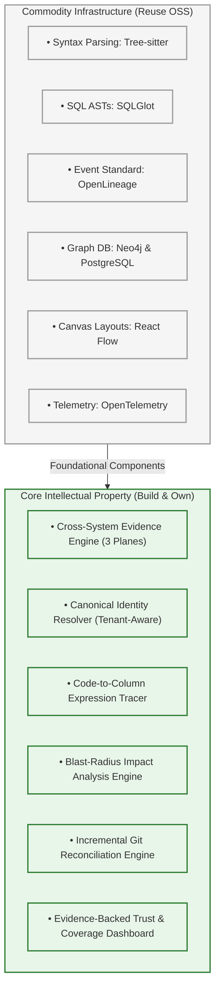

---

# 12. Enterprise Risk Management Matrix

| Risk | Why It Matters | Concrete Engineering Mitigation |
| :--- | :--- | :--- |
| **False-Positive Edges** | Users lose trust; impact alerts become ignored noise. | Mandatory evidence for every edge; ground-truth evaluation set; precision target >95%. |
| **Silent Coverage Gaps** | A partial graph creates a false sense of security. | Explicit **Coverage Dashboard** reporting unparsed files, permission denials, and unknown edges. |
| **Dynamic SQL Obfuscation**| Runtime queries cannot be parsed statically. | Augment with query audit history (`pg_stat_statements`, Snowflake query history). Flag dynamic strings as `UNKNOWN`. |
| **Identity Clashes** | Cross-environment tables mistakenly merge. | Strict canonical 6-tuple URIs (`tenant:env:cluster:db:schema:table`). Never auto-merge without deterministic match. |
| **Graph UI Overload** | 10,000+ nodes turn into an unreadable "hairball." | Progressive disclosure: subgraphs collapsed by default; search-first entry; bounded depth limits. |
| **Stale Evidence** | Outdated code or expired temp tables mislead engineers. | Watermark every run. Mark superseded edges as `STALE` with audit history. |
| **LLM Hallucinations** | Plausible but false dependencies appear in the graph. | LLMs act strictly as proposers; edges without verifiable physical evidence are discarded. |
| **Credential / Data Leakage**| Sensitive customer PII or credentials indexed. | Automated entropy and regex-based secret scrubbing prior to ingestion; read-only credentials; zero row-level data storage. |

---

# 13. Pilot Acceptance Criteria & Quality Metrics

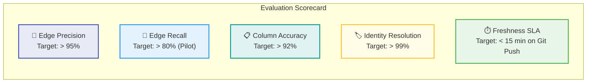

### 15 Pilot Acceptance Verification Checklist
- [ ] **1. Canonical Identity Search:** Users can search any table and inspect its unique 6-tuple identity.
- [ ] **2. Bidirectional Traversal:** Full upstream and downstream navigation from any supported node.
- [ ] **3. Data Flow vs. Control Flow:** The graph clearly distinguishes `TRANSFORMS_TO` from Airflow `DEPENDS_ON`.
- [ ] **4. Table-to-Code Traceability:** Every table edge links directly to source code or metadata proof.
- [ ] **5. Column Lineage Accuracy:** Column mapping works accurately for the documented SQL dialect subset.
- [ ] **6. Inspectable Evidence:** Clicking any edge opens an inspectable proof record with file and line numbers.
- [ ] **7. Diagnostic Coverage:** Unparsed files or unsupported syntax are prominently displayed in the Coverage Dashboard.
- [ ] **8. Multi-Environment Isolation:** Tables in `dev`, `staging`, and `prod` never merge erroneously.
- [ ] **9. Incremental Git Refresh:** Pushing a single-file commit re-parses only that file and its symbol neighbors.
- [ ] **10. Change Impact Blast Radius:** Selecting a column produces an accurate, filtered list of downstream affected assets.
- [ ] **11. Permission & Connector Diagnostics:** Credential failures and extraction errors are clearly logged.
- [ ] **12. Idempotent Processing:** Re-running extraction on unchanged inputs yields an identical graph checksum.
- [ ] **13. Measured Precision & Recall:** Precision, recall, and identity accuracy are scored against ground truth.
- [ ] **14. Deterministic Offline Mode:** System operates completely and accurately with external LLM connections disabled.
- [ ] **15. Security & License Compliance:** Secret scrubbing verified; SBOM and license checks completed.

---

# 14. Comprehensive Glossary of Terms

| Term | Architectural Definition |
| :--- | :--- |
| **Data Lineage** | The recorded lifecycle of data: its origins, intermediate code transformations, movements, and terminal consumers. |
| **Upstream** | The source side of a dependency (where data originated), relative to the selected asset. |
| **Downstream** | The consumer side of a dependency (who uses or consumes data), relative to the selected asset. |
| **Edge** | A directed relationship connecting two vertices in the property graph (e.g., `READS_FROM`, `TRANSFORMS_TO`). |
| **Evidence** | Physical proof backing an edge: source file, line numbers, commit hash, query ID, and timestamp. |
| **Static Evidence** | Inferred from source code and configuration files without executing the workloads. |
| **Metadata Evidence** | Extracted from database information schemas, data catalogs (DataHub), and orchestrator manifests. |
| **Runtime Evidence** | Observed from active executions: OpenLineage events, query logs, and distributed traces. |
| **Control Dependency** | Job execution ordering where Task B waits for Task A without consuming data produced by Task A. |
| **Canonical Identity** | A unique, environment-scoped identifier (6-tuple URI) preventing cross-environment name collisions. |
| **AST (Abstract Syntax Tree)**| Structured hierarchical representation of code or SQL syntax generated by parsers (Tree-sitter, SQLGlot). |
| **CTE (Common Table Expression)**| Temporary named result set defined in SQL via the `WITH` clause; resolved by SQLGlot for column lineage. |
| **OpenLineage** | Standardized open-source JSON event protocol for emitting runtime job and dataset telemetry. |
| **Data Catalog** | Enterprise inventory platform (DataHub, OpenMetadata) indexing tables, descriptions, and business glossary terms. |
| **Blast Radius** | The full downstream subtree of assets, pipelines, and dashboards impacted if an upstream node is modified. |
| **SBOM (Software Bill of Materials)**| Complete inventory of all software dependencies, versions, and licenses ensuring commercial compliance. |
| **RBAC / ABAC** | Role-Based and Attribute-Based Access Control enforcing granular security policies on graph queries. |

---

> **The Platform Commitment:**  
> *"Trace any data dependency across enterprise code, jobs, and databases with inspectable proof, visible uncertainty, and zero hallucinations."*  
> 
> 📦 **GitHub Repository:** [https://github.com/TestAccount-04/datalineage.git](https://github.com/TestAccount-04/datalineage.git)  
> 🌐 **Interactive Lineage Studio:** Launch [`index.html`](index.html) to interact with live nodes, directed edges, and forensic proof models.
