# Enterprise Data Lineage & Dependency Platform
> **Architecture Blueprint & Implementation Guide**  
> *Transforming fragmented code, metadata, and runtime events into a unified, evidence-backed dependency graph.*

---

## Executive Summary

Modern enterprises operate heterogeneous technology estates—spanning Java/Python microservices, SQL stored procedures, ETL tools (dbt, Airflow, Spark), Kafka event streams, cloud warehouses (Snowflake, BigQuery), and BI semantic layers. No single tool or repository holds the complete dependency truth.

Traditional lineage tools fail because they either:
1. **Rely purely on code parsing** (missing runtime reality, dynamic SQL, and external data movement).
2. **Rely purely on catalogs/metadata** (missing granular column transformations, method logic, and uncataloged repos).
3. **Over-rely on LLMs** (resulting in plausible-looking hallucinations and costly compute bills).

### The Solution: A Unified 3-Plane Lineage Fabric
Instead of a single standard or guessing engine, this platform implements a **deterministic-first, evidence-backed lineage engine** combining three distinct evidence planes:

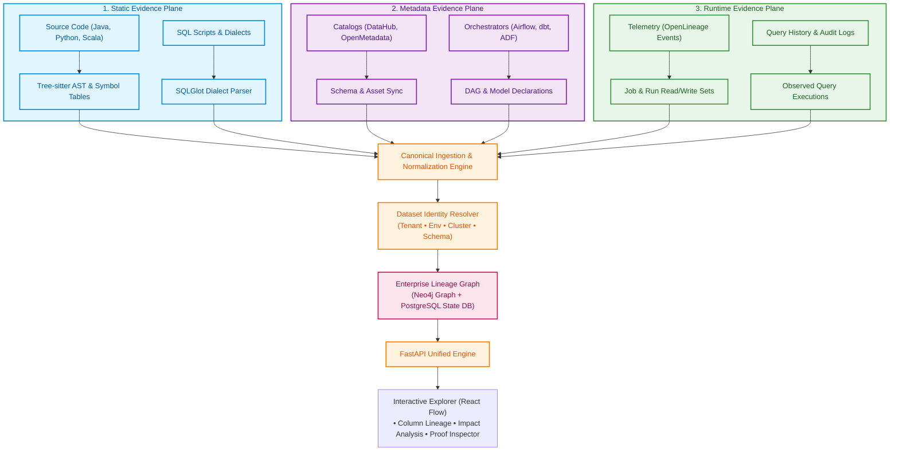

---

### Core Stack at a Glance

| Layer | Recommended Choice | Rationale & Trade-offs |
| :--- | :--- | :--- |
| **Code Parsing** | **Tree-sitter** + Custom Language Adapters | Fast, error-tolerant ASTs across multi-language codebases. |
| **SQL Parsing** | **SQLGlot** | First-class multi-dialect SQL AST traversal and transpilation in Python. |
| **Runtime Standards** | **OpenLineage** | Industry-standard event schema for job/run datasets; ingest without forcing adoption. |
| **Catalogs** | **DataHub & OpenMetadata Adapters** | Bi-directional connector model; integrates with existing enterprise catalogs. |
| **Graph Database** | **Neo4j** (Graph Store) + **PostgreSQL** (State Store) | Neo4j for lightning-fast multi-hop traversals; PostgreSQL for tenant metadata, audit, and run state. |
| **API Backend** | **FastAPI (Python)** | High-throughput async REST API aligned with modern data engineering tooling. |
| **UI Visualization** | **React Flow** (Core UI) / **Cytoscape.js** (Deep Graphs) | Highly responsive, customizable node-edge canvas with progressive drill-down. |
| **AI / LLMs** | **Gated LLM Gateway (Optional)** | Restricted strictly to candidate suggestions, complex regex explanation, and natural language summaries. Never invents facts. |

---

## 1. Problem Definition & Enterprise Realities

Data lineage answers the fundamental lifecycle questions of data: **Where did it come from? Who modified it? What columns were affected? And if I change this code today, what breaks downstream?**

### 1.1 Lineage Navigation Hierarchy
The platform provides unbroken traversal across seven hierarchical tiers:

```mermaid
graph LR
    L1["🏢 Enterprise Domain"] --> L2["📦 Application / Service"]
    L2 --> L3["⚙️ Pipeline / Job"]
    L3 --> L4["🗄️ Dataset / Table / Topic"]
    L4 --> L5["📋 Field / Column"]
    L5 --> L6["💻 Code Symbol / SQL AST"]
    L6 --> L7["⏱️ Runtime Execution Event"]

    style L1 fill:#e8eaf6,stroke:#3f51b5,stroke-width:2px;
    style L2 fill:#e3f2fd,stroke:#2196f3,stroke-width:2px;
    style L3 fill:#e0f2f1,stroke:#009688,stroke-width:2px;
    style L4 fill:#f1f8e9,stroke:#8bc34a,stroke-width:2px;
    style L5 fill:#fffde7,stroke:#fbc02d,stroke-width:2px;
    style L6 fill:#fff3e0,stroke:#ff9800,stroke-width:2px;
    style L7 fill:#ffebee,stroke:#f44336,stroke-width:2px;
```

### 1.2 Why Enterprise Lineage Fails Without Evidence
- **Ghost Branches:** Static code describes potential branches that may never execute in production.
- **Dynamic SQL:** Queries generated dynamically across runtime string concatenations break naive static parsers.
- **Job vs. Data Conflation:** An Airflow task dependency (`Task B >> Task A`) describes *scheduling order*, not necessarily *data flow*.
- **Identity Clashes:** `prod.sales.orders` and `SALES.ORDERS` might be the exact same table, or two distinct tables in different environments.
- **Unverified AI Inferences:** Generic LLMs hallucinate plausible-looking edges that do not exist in reality.

> [!IMPORTANT]
> **Core Tenet:** "100% automated lineage from Git alone" is an impossible claim. Enterprise trust requires **measured coverage, explicit evidence provenance, and clearly visible coverage gaps**.

---

## 2. Foundational Design Principles

1. **Deterministic-First:** Syntax trees, catalog APIs, query logs, and schemas are authoritative. LLMs are never the primary source of truth.
2. **Evidence-Backed Edges:** Every relationship points to an auditable artifact (file, line number, SQL statement, run ID, or timestamp).
3. **Separate "Potential" from "Observed":** Static analysis defines *possible* paths; runtime telemetry defines *observed* paths.
4. **Canonical Identity Subsystem:** Assets are matched via rigorous contextual hashing (tenant, environment, cluster, database, schema, table).
5. **Unknown is a Valid Output:** If an edge cannot be proven, the engine exposes a diagnostic gap rather than guessing.
6. **Incremental & Idempotent:** Incremental updates re-parse only modified commits or changed catalog entities—never a complete graph drop-and-rebuild.
7. **Zero-Trust Security:** Secret redaction before indexing, least-privilege collector credentials, and complete tenant boundary isolation.

---

## 3. The 3 Evidence Planes

Lineage edges are classified into three distinct evidence categories:

| Evidence Plane | Sources | Primary Strengths | Inherent Limitations |
| :--- | :--- | :--- | :--- |
| **Static Evidence** | Git repositories, Java/Python code, dbt YAML, SQL files, OpenAPI specs. | Immediate availability; doesn't require production execution; catches rare paths. | Cannot guarantee which branch executed; struggles with dynamic SQL strings. |
| **Metadata Evidence** | DB Information Schemas, DataHub, OpenMetadata, Glue, Airflow DAGs. | Authoritative structural schemas, table definitions, and explicit ownership. | Lacks internal code transformations; bounded by vendor tool boundaries. |
| **Runtime Evidence** | OpenLineage events, query audit logs (Snowflake, BigQuery), distributed traces. | Proves exact datasets read/written in real production executions. | Limited to observation windows; missing unexecuted disaster/reconciliation jobs. |

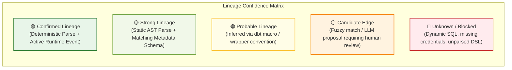

---

## 4. Canonical Data Model & Graph Schema

The internal graph uses an extensible, vendor-agnostic property graph schema.

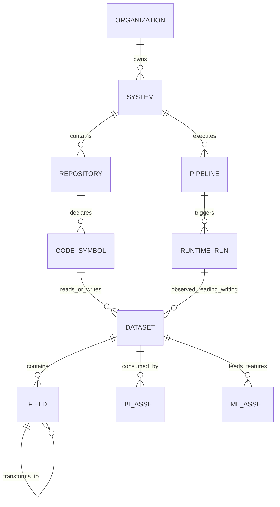

### 4.1 Core Entity & Relationship Definitions

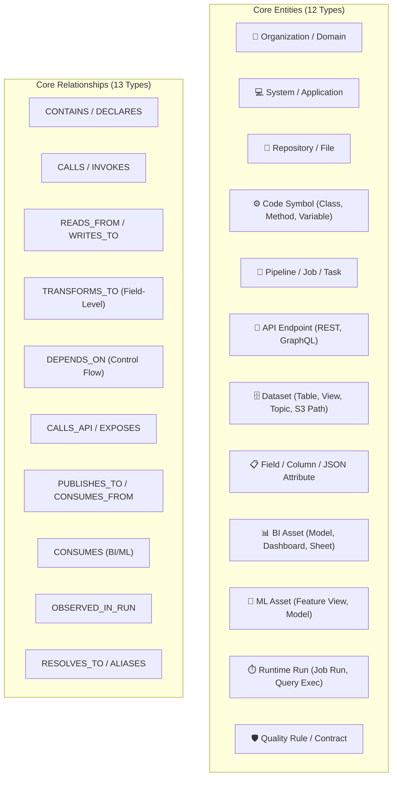

### 4.2 Evidence Record Schema
Every edge in the graph carries rich provenance:

```json
{
  "edge_id": "edge_dbt_snowflake_daily_orders_01",
  "source_entity_id": "dataset://snowflake/prod/analytics/orders",
  "target_entity_id": "dataset://snowflake/prod/analytics/daily_revenue",
  "relationship_type": "TRANSFORMS_TO",
  "evidence_plane": "static",
  "evidence_type": "ast_sql_parse",
  "source_system": "dbt_core",
  "source_location": "models/marts/finance/daily_revenue.sql:34-48",
  "source_version": "git:sha_8f4bc92a",
  "observed_at": null,
  "valid_from": "2026-10-10T08:00:00Z",
  "confidence_score": 0.98,
  "confidence_class": "STRONG",
  "verification_status": "ACCEPTED",
  "metadata": {
    "dialect": "snowflake",
    "parser": "SQLGlot 23.0",
    "transformation_logic": "SUM(orders.amount) GROUP BY orders.order_date"
  }
}
```

---

## 5. Engineering Challenges & Concrete Solutions

The platform resolves 12 real-world enterprise engineering obstacles:

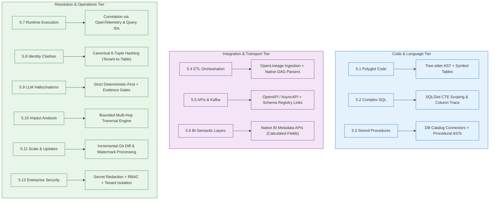

### Detailed Breakdown of Solutions

#### 5.1 Multi-Language Codebases (Java, Python, Scala, SQL)
- **Challenge:** Enterprise repositories mix programming languages, frameworks, and custom wrappers.
- **Solution:** Deploy **Tree-sitter** for universal syntax trees. Use language-specific analyzers (Python AST, Java JDT) to resolve import statements, method signatures, and framework I/O sinks (`spark.read.table()`, `psycopg2.execute()`, `JdbcTemplate`). Unresolved dynamic invocations are tagged as `UNKNOWN_CALL`, never fabricated.

#### 5.2 SQL & Granular Column-Level Lineage
- **Challenge:** Nested CTEs, `CASE` statements, window functions, and union queries obscure direct column sources.
- **Solution:** Standardize on **SQLGlot** for Python-native parsing across 20+ SQL dialects (Snowflake, BigQuery, PostgreSQL, SparkSQL). The column engine traces column expressions backwards through nested CTE scopes to their physical source tables. Non-direct dependencies (such as columns used in `JOIN`, `WHERE`, or `GROUP BY` clauses) are recorded as `INDIRECT_DERIVATION` edges.

#### 5.3 Stored Procedures & Database-Side Logic
- **Challenge:** Business logic trapped inside Oracle PL/SQL, Microsoft T-SQL, or PostgreSQL stored procedures.
- **Solution:** Extract procedure DDL using read-only database catalog connections. Parse procedural bodies for DML statements (`INSERT INTO ... SELECT`, `MERGE`). Validate actual execution frequency against runtime query history views (`sys.dm_exec_query_stats`, `pg_stat_statements`).

#### 5.4 ETL & Orchestration Pipelines (Airflow, dbt, Spark)
- **Challenge:** DAG task sequence does not equal data movement.
- **Solution:** Native manifest parsing for dbt (`manifest.json` provides perfect model and column lineage). Ingest **OpenLineage** runtime events for Spark and Airflow jobs to capture exact runtime inputs and outputs. Maintain a hard boundary between `DEPENDS_ON` (control flow) and `TRANSFORMS_TO` (data flow).

#### 5.5 APIs, Event Streams & Microservices (Kafka, REST)
- **Challenge:** Data transitions across HTTP boundaries or Kafka queues without direct database links.
- **Solution:** Parse OpenAPI/AsyncAPI specifications and client HTTP calls. Map Kafka producer topics to consumer topics via Schema Registry schemas. Represent endpoints and message topics as explicit intermediate nodes:
  $$\text{Service A} \xrightarrow{\text{PUBLISHES}} \text{Topic: orders} \xrightarrow{\text{CONSUMES}} \text{Service B}$$

#### 5.6 BI & Semantic Layers (Tableau, PowerBI, Looker)
- **Challenge:** Lineage breaks at the dashboard boundary; calculated fields and semantic measures remain opaque.
- **Solution:** Ingest BI project files and metadata APIs. Map Dashboard $\rightarrow$ Sheet $\rightarrow$ Semantic Model / Measure $\rightarrow$ Database View $\rightarrow$ Underlying Physical Table.

#### 5.7 Runtime Transaction Lineage
- **Challenge:** Static code shows all possible execution paths; runtime telemetry shows only what executed in a specific window.
- **Solution:** Associate execution run IDs, query IDs, and distributed trace IDs (OpenTelemetry) with static nodes. Explicitly stamp edges with an `observation_window`.

#### 5.8 Canonical Identity Resolution
- **Challenge:** Conflicting identifiers: `db.schema.tbl`, `PROD.TBL`, `env_prod_cluster_01.db.tbl`.
- **Solution:** Normalize every physical dataset into a deterministic canonical URI:
  `dataset://{platform}/{tenant}/{environment}/{cluster}/{database}/{schema}/{table_name}`
  Fuzzy name suggestions are recorded only as candidate aliases pending human or rule-based approval.

#### 5.9 LLM Hallucination & Cost Containment
- **Challenge:** Large language models hallucinate plausible connections and run up large API bills.
- **Solution:**
  - LLMs are **never** used for syntax or table discovery.
  - Used only for summarizing complex lineage graphs, parsing messy legacy regexes, or proposing candidate links.
  - LLM output must strictly match a JSON schema referencing existing verified nodes. Any edge referencing non-existent nodes is rejected.
  - Engine works 100% deterministically with LLMs disabled.

#### 5.10 Change Impact Analysis
- **Challenge:** Engineers cannot predict the blast radius of modifying a column or table schema.
- **Solution:** Downstream graph traversal with configurable traversal depth and severity filters. Distinguishes direct breaking impacts (e.g., dropping a referenced column) from transitive downstream dependencies (e.g., a dashboard 4 hops away).

#### 5.11 Scalability & Incremental Processing
- **Challenge:** Full graph rebuilds on million-line repositories or enterprise databases are slow and unscalable.
- **Solution:** Git commit diffing triggers extraction only for altered files and affected symbol neighborhoods. Connector watermarks track database schema change logs (`schema_version`).

#### 5.12 Enterprise Security & Governance
- **Challenge:** Exposing proprietary code, customer schemas, or embedded credentials.
- **Solution:** Automatic secret scrubbing (passwords, tokens, API keys) prior to graph ingestion. Strict tenant isolation, RBAC-filtered graph querying, and private on-premises / VPC deployment compatibility.

---

## 6. Open-Source & Tooling Evaluation Matrix

| Category | Recommended Choice | Alternatives Evaluated | Trade-off Analysis |
| :--- | :--- | :--- | :--- |
| **Code ASTs** | **Tree-sitter** | GitNexus, Language Native ASTs (Java JDT, Python `ast`) | Tree-sitter provides universal, resilient syntax trees across multiple languages. GitNexus is evaluated as a helpful symbol-graph reference. |
| **SQL Engine** | **SQLGlot** | OpenLineage SQL, Catalog Parsers, Regex | SQLGlot is dialect-rich, actively maintained, and handles transpilation and scope resolution cleanly in Python. Regex is rejected as brittle. |
| **Lineage Protocol** | **OpenLineage** | Proprietary JSON formats | OpenLineage provides standard runtime facets and integrations (Spark, Airflow). We ingest OpenLineage without forcing proprietary standard changes. |
| **Metadata Catalogs**| **DataHub & OpenMetadata** | Native DB queries | Build adapters for existing deployments. Maintain our own internal canonical model so our platform is never locked into a catalog's schema. |
| **Graph Storage** | **Neo4j** (Traversals) + **PostgreSQL** (Metadata/Audit) | Apache AGE, Memgraph, Relational-only | Neo4j delivers native Cypher traversals and multi-hop speed. PostgreSQL guarantees ACID state storage, job tracking, and tenancy. |
| **UI Canvas** | **React Flow** | Cytoscape.js, D3.js, Mermaid | React Flow provides a rich, modern component-based canvas with node expansion, zoom controls, and custom edge badges. |
| **API & Ingestion** | **FastAPI** + **Redis/Celery Queue** | Spring Boot, Kafka | FastAPI delivers fast asynchronous Python endpoints. Redis/Celery handles background connector tasks cleanly without premature Kafka complexity. |

---

## 7. Extraction Pipeline Architecture

The end-to-end ingestion lifecycle follows a strict 10-stage sequential pipeline:

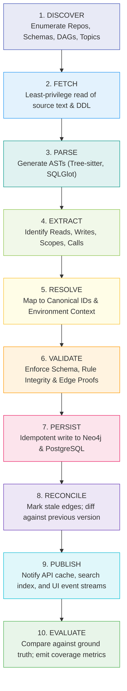

---

## 8. Real-World End-to-End Walkthrough

To demonstrate cross-system, multi-evidence resolution, consider a typical enterprise financial pipeline:

```mermaid
flowchart LR
    subgraph S_POSTGRES["PostgreSQL (OLTP)"]
        T1["orders<br/>(id, cust_id, amount)"]
        T2["customers<br/>(id, credit_score, email)"]
    end

    subgraph S_JAVA["Java Microservice (Risk Engine)"]
        M1["RiskService.calculateScore()<br/>• Static AST: Tree-sitter<br/>• File: RiskService.java:112"]
    end

    subgraph S_PYTHON["Scheduled Python Pipeline"]
        P1["batch_risk_enricher.py<br/>• Writes: risk_enriched_orders<br/>• Runtime: OpenLineage Run #4812"]
    end

    subgraph S_SNOWFLAKE["Snowflake Data Warehouse"]
        D1["dbt: daily_risk_summary<br/>• SQLGlot Dialect Parse<br/>• CTE Aggregate Logic"]
    end

    subgraph S_BI["Executive BI Layer"]
        B1["Semantic Model: RiskMetrics"]
        B2["Executive Risk Dashboard<br/>• Visualizes: risk_category"]
    end

    T1 & T2 -->|READS_FROM| M1
    M1 -->|TRANSFORMS_TO| P1
    P1 -->|WRITES_TO| D1
    D1 -->|FEEDS| B1
    B1 -->|RENDERS| B2

    classDef pg fill:#e3f2fd,stroke:#1565c0,stroke-width:1.5px;
    classDef jv fill:#f3e5f5,stroke:#7b1fa2,stroke-width:1.5px;
    classDef py fill:#e8f5e9,stroke:#2e7d32,stroke-width:1.5px;
    classDef sf fill:#e0f7fa,stroke:#00838f,stroke-width:1.5px;
    classDef bi fill:#fff3e0,stroke:#e65100,stroke-width:1.5px;

    class S_POSTGRES,T1,T2 pg;
    class S_JAVA,M1 jv;
    class S_PYTHON,P1 py;
    class S_SNOWFLAKE,D1 sf;
    class S_BI,B1,B2 bi;
```

### Granular Evidence Behind Each Edge

1. **`customers` $\rightarrow$ `RiskService.calculateScore()`**
   - *Evidence:* Static AST parse (`Tree-sitter`) identifying `PreparedStatement` with query `SELECT id, credit_score FROM customers`.
   - *Confidence:* **Strong (0.95)**.
2. **`RiskService` $\rightarrow$ `risk_enriched_orders`**
   - *Evidence:* Python script execution observed via OpenLineage run facet + Git commit `sha_109c2`.
   - *Confidence:* **Confirmed (0.99)**.
3. **`risk_enriched_orders` $\rightarrow$ `daily_risk_summary`**
   - *Evidence:* dbt `manifest.json` + `SQLGlot` AST analysis mapping `SUM(risk_score)` to `daily_aggregate`.
   - *Confidence:* **Strong (0.98)**.
4. **`daily_risk_summary` $\rightarrow$ `Executive Risk Dashboard`**
   - *Evidence:* BI Metadata API extracting workspace dataset bindings and visual card field definitions.
   - *Confidence:* **Strong (0.96)**.

---

## 9. Change Impact Analysis Engine

When an engineer modifies code or an upstream schema, the impact engine calculates the downstream blast radius:

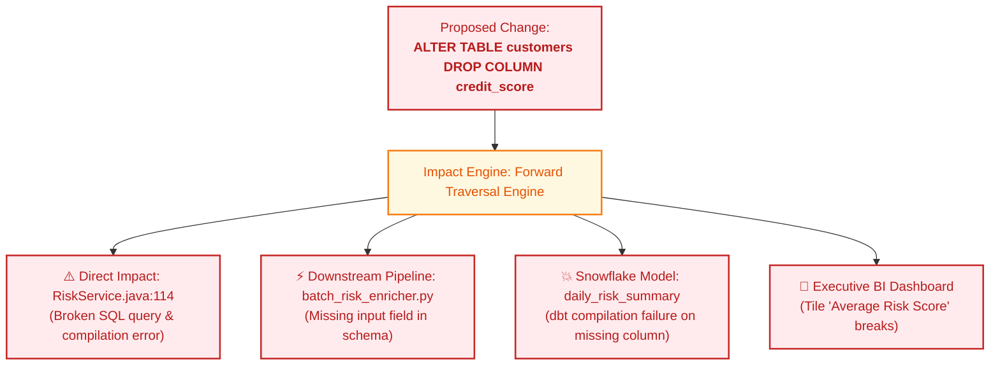

### Impact Report Output (JSON API)
```json
{
  "target_asset": "snowflake://prod/customers.credit_score",
  "change_type": "DROP_COLUMN",
  "blast_radius_summary": {
    "total_affected_entities": 4,
    "direct_dependencies": 1,
    "transitive_dependencies": 3,
    "maximum_depth": 4,
    "highest_severity": "BREAKING"
  },
  "affected_nodes": [
    {
      "node_id": "code://repo/risk-service/RiskService.java#calculateScore",
      "type": "CODE_SYMBOL",
      "owner": "risk-platform-team",
      "impact_type": "DIRECT_BREAKING"
    },
    {
      "node_id": "dashboard://bi/executive-risk-kpi",
      "type": "BI_DASHBOARD",
      "owner": "vp-risk",
      "impact_type": "TRANSITIVE_BREAKING"
    }
  ]
}
```

---

## 10. Verification, Quality Metrics & Acceptance

We measure the lineage engine by ground-truth correctness, not by whether a pretty graph renders:

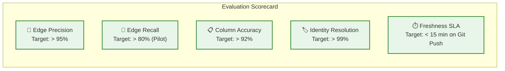

### Strict Validation Gates
1. **No Orphan Edges:** Every edge must bind to existing source and target entities.
2. **Provenance Obligation:** Code edges must contain file path and line numbers; runtime edges must contain execution IDs and timestamps.
3. **Multi-Environment Isolation:** Tables in `dev`, `staging`, and `prod` never merge automatically based on identical names.
4. **Idempotency Guarantee:** Re-running extraction on an unmodified repository produces an identical graph checksum.
5. **Deterministic Baseline:** The engine must execute completely and correctly with all external LLM connections disabled.

---

## 11. Delivery Roadmap & 90-Day Pilot Plan

```mermaid
gantt
    title Lineage Platform Delivery Plan
    dateFormat  YYYY-MM-DD
    section Pilot (First 90 Days)
    Phase 0: Scope & Ground Truth Set       :active, p0, 2026-10-15, 7d
    Phase 1: Code & SQL Parser Prototype    :p1, after p0, 21d
    Phase 2: Identity & Evidence Registry   :p2, after p1, 14d
    Phase 3: Column Lineage & Metadata      :p3, after p2, 21d
    Phase 4: Cross-System & Impact UI       :p4, after p3, 21d
    section Hardening & Expansion
    Phase 5: Pilot Hardening & Security     :p5, after p4, 60d
    Phase 6: Multi-Tenant Enterprise Scale  :p6, after p5, 180d
```

### First 90 Days Sprint Milestones

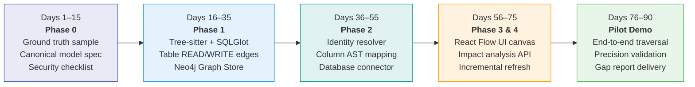

---

## 12. Build vs. Reuse Strategy

To accelerate time-to-market while protecting proprietary value:

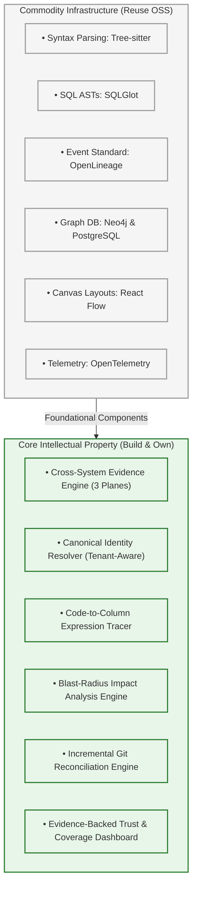

---

## 13. Risk Management Matrix

| Risk | Impact | Concrete Mitigation |
| :--- | :--- | :--- |
| **False-Positive Edges** | Users lose trust; impact analysis alerts become spam. | Require inspectable evidence for every edge. Strict validation gates and expert ground-truth benchmarking. |
| **Silent Coverage Gaps** | Incomplete graph appears artificially comprehensive. | Dedicated **Coverage Dashboard** explicitly reporting unparsed files, permission denials, and unknown edges. |
| **Dynamic SQL Obfuscation**| Runtime string queries cannot be parsed statically. | Augment with query audit logs (Snowflake query history, Postgres stats). Flag unresolvable strings as `UNKNOWN`. |
| **Identity Clashes** | Cross-environment tables with the same name erroneously merge. | Deterministic canonical 6-tuple URIs (`tenant:env:cluster:db:schema:table`). Never fuzzy-merge production assets. |
| **Graph UI Overload** | Graph of 10,000+ nodes turns into an unreadable "hairball." | Progressive disclosure in React Flow: collapse subgraphs by default, search-first entry points, bounded depth filters. |
| **Stale Lineage** | Outdated code or expired temporary tables remain visible. | Timestamp every extraction run. Mark superseded edges as `STALE` with audit history. |
| **LLM Cost & Hallucinations**| Runaway API bills and fabricated relationships. | Strict rule: LLMs cannot generate edges without referencing verified evidence. Enforce token budgets and offline deterministic mode. |
| **Proprietary IP Leakage** | Code, secrets, or sensitive schemas exposed to external endpoints.| Automatic secret scrubbing on ingestion; local/VPC model routing; support air-gapped deployments. |

---

## 14. What the User Sees: Final Platform Experience

When an engineer, data architect, or compliance auditor selects any data asset, the platform displays an interactive, evidence-backed dossier:

```text
┌────────────────────────────────────────────────────────────────────────────────────────┐
│  DATASET: snowflake://prod/analytics/daily_revenue                                     │
│  Owner: Finance Data Team   |   Freshness: 12m ago   |   Trust Score: 98% (Strong)     │
├────────────────────────────────────────────────────────────────────────────────────────┤
│                                                                                        │
│  [ UPSTREAM LINEAGE ]                                                                  │
│  ◄── orders (Snowflake table)                                                          │
│      └── Evidence: models/marts/finance/daily_revenue.sql:34                           │
│  ◄── RiskService.calculateScore() (Java Service)                                       │
│      └── Evidence: src/main/java/com/corp/risk/RiskService.java:112                    │
│                                                                                        │
│  [ DOWNSTREAM IMPACT ]                                                                 │
│  ──► Executive Revenue Dashboard (PowerBI)                                             │
│      └── Owner: VP Finance | Direct Dependent: revenue_sum                             │
│                                                                                        │
│  [ COLUMN MAPPING & PROOF ]                                                            │
│  • daily_revenue.revenue_sum <── SUM(orders.amount)                                    │
│    ├── Source AST: SQLGlot Dialect AST (Snowflake)                                     │
│    └── Verified In Run: OpenLineage Run #8912 (2026-10-10 11:45 UTC)                    │
│                                                                                        │
│  [ COVERAGE & AUDIT ]                                                                  │
│  • Verified Evidence: Static AST (98%) + OpenLineage Runtime (Confirmed)               │
│  • Unknowns / Blocked: 0 issues detected                                               │
└────────────────────────────────────────────────────────────────────────────────────────┘
```

> **The Platform Promise:**  
> *"Trace any data dependency across enterprise code, jobs, and databases with inspectable proof, visible uncertainty, and zero hallucinations."*
